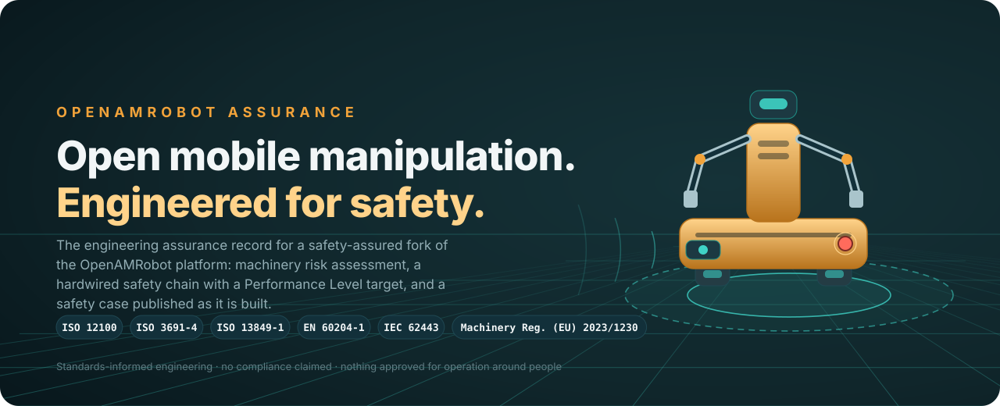
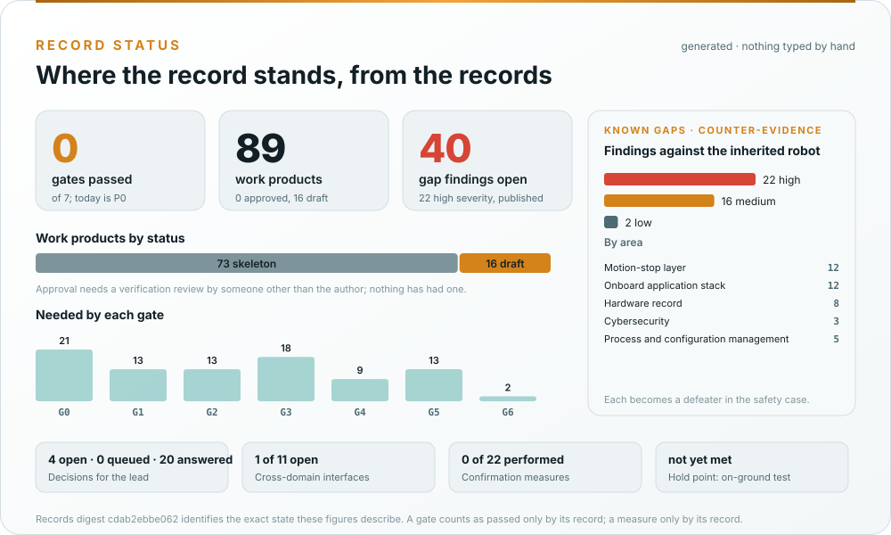
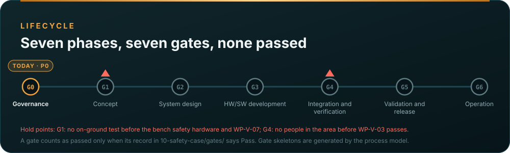

<p align="center">
  
</p>

<p align="center">
  <b>The engineering assurance record for a safety-assured fork of the OpenAMRobot mobile manipulator: machinery risk assessment, a hardwired safety chain with a Performance Level target, cybersecurity and machine-learning safety, and a safety case published as it is built.</b>
</p>

<p align="center">
  <a href="docs/README.md">Documentation</a> &nbsp;·&nbsp;
  <a href="https://github.com/jherrodthomas/openamrobot-assurance/wiki">Wiki</a> &nbsp;·&nbsp;
  <a href="#the-assurance-record">Record status</a> &nbsp;·&nbsp;
  <a href="#safety-architecture">Architecture</a> &nbsp;·&nbsp;
  <a href="#standards-and-engineering-framework">Standards</a> &nbsp;·&nbsp;
  <a href="#roadmap">Roadmap</a> &nbsp;·&nbsp;
  <a href="#known-gaps">Known gaps</a> &nbsp;·&nbsp;
  <a href="#getting-started">Getting started</a> &nbsp;·&nbsp;
  <a href="#contributing">Contributing</a>
</p>

<p align="center">
  <a href="https://github.com/jherrodthomas/openamrobot-assurance/actions/workflows/assurance.yaml"></a>
  <a href="https://github.com/jherrodthomas/openamrobot-assurance/actions/workflows/wiki.yaml"></a>
  <a href="LICENSE"></a>
  <a href="assurance/01-management/decisions/README.md"></a>
  <a href="assurance/00-assessment/gap-assessment.md"></a>
</p>

> [!IMPORTANT]
> **OpenAMRobot is research hardware and this record is a draft prepared for engineering review.** Nothing here has
> passed verification review, confirmation review or a functional safety assessment. The robot is not CE-marked,
> no safety function reaches any Performance Level under ISO 13849-1 today, and no configuration is approved for
> operation around people. The [gap assessment](assurance/00-assessment/gap-assessment.md) says exactly what is missing.

## Why this exists

[OpenAMRobot](https://github.com/openAMRobot) is an open mobile manipulator platform by Botshare LTD. Its
architecture has the right shape for a safety argument: a large ROS 2 stack in front of a small firmware layer on a
separate microcontroller that is the last thing before the motors. What it lacks, by its own account, is the safety
engineering: no risk assessment, no emergency stop in the documented wiring, no brakes, no fuse, no safety-rated
personnel detection, and no verification of the firmware. This fork keeps upstream's code and adds the record
around it, under the standards that apply to a machine.

## The assurance record

Every work product lives under [`assurance/`](assurance/README.md), numbered in lifecycle order, with a
document-control header that says what it is, which clauses it answers to, and whether anyone has reviewed it.
Nothing is marked complete before its review, and every number below is computed from the records by
[`make_assets.py`](docs/assets/openamrobot/make_assets.py) and checked by CI on every pull request.

<p align="center">
  
</p>

<!-- BEGIN GENERATED: record-headline (docs/assets/openamrobot/make_assets.py) -->

**P0 Governance** · no gate passed · 89 work products (9 draft, 80 skeleton, 0 approved) · 40 gap findings (22 high) · 9 decisions open · 1 of 11 cross-domain interfaces open · 0 of 22 confirmation measures performed · records digest `2dac649e5449`

<!-- END GENERATED: record-headline -->

<p align="center">
  
</p>

| What the card guarantees | |
|---|---|
| A gate counts as passed | only when its record in [`10-safety-case/gates/`](assurance/10-safety-case/gates/README.md) says Pass; a skeleton generated from the process model is not a record |
| A work product counts as approved | only after a verification review by someone other than its author ([WP-P-05](assurance/07-supporting/WP-P-05-verification-review-procedure.md)); a confirmation measure counts only by its record under [`confirmation/`](assurance/10-safety-case/confirmation/README.md) |
| The Living Safety Case dashboard | is [planned](assurance/case/README.md): claims, evidence with review state and defeaters as records, with a validator that refuses an accepted claim whose evidence is not accepted. Until it exists, no claim is made anywhere on this page |
| The records digest | identifies the exact state of the register, the gap assessment, the decision register, the process model and the gate and confirmation records these figures describe, so two readers can confirm they saw the same state |

**Start here:** [assurance strategy (WP-M-01)](assurance/01-management/WP-M-01-assurance-strategy.md) · [safety plan (WP-M-02)](assurance/01-management/WP-M-02-safety-plan.md) · [process model and maps (WP-P-11)](assurance/process/README.md) · [test operations hold point (WP-V-07)](assurance/06-validation/WP-V-07-test-operations.md) · [decision register](assurance/01-management/decisions/README.md)

> **Assurance status represents recorded engineering evidence and review state. It does not constitute certification or approval for operation around people.**

## Safety architecture

<p align="center">
  
</p>

The argument is a doer-and-checker argument with one more step. The ROS 2 stack proposes; the firmware
checks; and a hardwired safety chain is the checker of last resort that nothing in software can override. Only the
chain carries a Performance Level target. The firmware and the ROS 2 stack are hardened so that the chain is rarely
demanded, and recorded as defence in depth.

| Layer | Role | State |
|---|---|---|
| ROS 2 functional stack | Navigation, docking, teleoperation, operator UI; in future a learned policy | Inherited; hardening proposed (command arbiter, docking inside the envelope, SROS2, pinned builds) |
| Teensy firmware | Validates, times out and clamps every command; reads driver faults; drives the brakes | Inherited; hardening proposed |
| Hardwired safety chain | Emergency stop, protective stop, brakes, power removal | **Does not exist yet.** Bench version first ([WP-V-07](assurance/06-validation/WP-V-07-test-operations.md)), product version in the [SRP/CS architecture](assurance/03-system/WP-S-03-srpcs-architecture.md) |
| Safety and assurance | Risk assessment, safety functions and PLr, PL calculation, validation, cybersecurity, safety case | Draft and skeleton work products, not yet reviewed |

More in the [architecture overview](docs/architecture.md) and [WP-M-01 §6](assurance/01-management/WP-M-01-assurance-strategy.md#6-safety-architecture-argument-the-central-strategy).

## Standards and engineering framework

<p align="center">
  
</p>

OpenAMRobot is a machine, so the frame is the machinery set, applied with one method: one hazard log, one
requirements database, generated figures, a safety case with its defeaters published. Work products
are structured after these standards and cite their clauses; **no compliance is claimed**, because no assessment has
been performed. [WP-M-01 §4](assurance/01-management/WP-M-01-assurance-strategy.md#4-the-standards-and-how-each-one-is-used)
explains how each standard is used and where it is tailored; the wiki's
[How we use each standard](https://github.com/jherrodthomas/openamrobot-assurance/wiki/How-we-use-each-standard) is
the plain-language version.

| Topic | Standard | Main work products |
|---|---|---|
| Risk assessment and reduction | ISO 12100:2010 | [Item definition](assurance/02-concept/WP-C-01-item-definition.md) · [Risk assessment](assurance/02-concept/WP-C-03-risk-assessment.md) · [Risk reduction concept](assurance/02-concept/WP-C-05-risk-reduction-concept.md) |
| Driverless industrial trucks, including AMRs | ISO 3691-4:2023 | [Safety functions and required PL](assurance/02-concept/WP-C-04-safety-functions-and-plr.md) |
| Industrial robots and collaborative operation (arms, later) | ISO 10218-1/-2:2025, ISO/TS 15066:2016 | [Human-robot interaction](assurance/02-concept/WP-C-06-human-robot-interaction-and-misuse.md) |
| Safety-related parts of control systems | ISO 13849-1:2023, ISO 13849-2:2012 | [SRP/CS architecture](assurance/03-system/WP-S-03-srpcs-architecture.md) · [PL calculation](assurance/04-hardware/WP-H-04-reliability-data-and-pl-calculation.md) · [Safety validation](assurance/06-validation/WP-V-01-safety-validation.md) |
| Where ISO 13849 runs out | IEC 62061:2021, IEC 61508:2010 | [Software safety requirements](assurance/05-software/WP-W-02-software-safety-requirements.md) · [Confirmation measures](assurance/01-management/WP-M-06-confirmation-measures-plan.md) |
| Electrical equipment, emergency stop, safeguard positioning | EN 60204-1:2018, ISO 13850:2015, ISO 13855:2024 | [Electrical safety](assurance/04-hardware/WP-H-05-electrical-safety.md) · [Stopping budget](assurance/03-system/WP-S-04-response-time-and-stopping-budget.md) |
| Cybersecurity | IEC 62443-4-1:2018, IEC 62443-4-2:2019 | [Threat and risk assessment](assurance/02-concept/WP-C-07-cybersecurity-threat-and-risk-assessment.md) · [Cybersecurity plan](assurance/01-management/WP-M-08-cybersecurity-plan.md) |
| Machine learning in safety functions | ISO/IEC TR 5469:2024 | [ML component definition](assurance/02-concept/WP-C-09-ml-component-definition-and-safety-requirements.md) · [ML safety plan](assurance/01-management/WP-M-09-ml-safety-plan.md) |
| Regulatory | Regulation (EU) 2023/1230 (Machinery), Regulation (EU) 2024/1689 (AI Act) | [Regulatory conformity strategy](assurance/01-management/WP-M-13-regulatory-conformity-strategy.md) |
| Safety case structure | UL 4600 principles | [Safety case](assurance/10-safety-case/WP-K-01-safety-case.md) |

| Supporting practice | Where it is applied |
|---|---|
| Integrated process model | [WP-P-11](assurance/process/README.md): activities, lanes, cross-domain interfaces and gates as data; generated swimlane maps and gate skeletons |
| Process capability | [ASPICE self-assessment, WP-M-12](assurance/01-management/WP-M-12-process-capability-baseline.md) |
| Performance limits of perception | ISO 21448 used as a method, not a standard, in the [insufficiency analysis](assurance/02-concept/WP-C-10-functional-insufficiency-analysis.md) |
| Safety analysis | [FMEA](assurance/08-analyses/WP-A-01-system-fmea.md) · [FTA](assurance/08-analyses/WP-A-02-fault-tree-analysis.md) · [CCF](assurance/08-analyses/WP-A-03-common-cause-failure-analysis.md) · [STPA](assurance/08-analyses/WP-A-04-stpa.md) · [Independence of the chain](assurance/08-analyses/WP-A-05-independence-of-the-safety-chain.md) |
| Independent review | [Confirmation measures plan](assurance/01-management/WP-M-06-confirmation-measures-plan.md) · [Verification and review procedure](assurance/07-supporting/WP-P-05-verification-review-procedure.md) |
| Decisions | [Decision register](assurance/01-management/decisions/README.md): every question for the project lead, self-contained, in batches of ten |

## Roadmap

<p align="center">
  
</p>

Status is taken from what exists in the repository. "Draft" means written but not reviewed; "skeleton" means the
structure and clause map exist and the content is still to be written.

| Phase | Work | Status |
|---|---|---|
| **1 · Foundation** | [Assurance strategy](assurance/01-management/WP-M-01-assurance-strategy.md), [safety plan](assurance/01-management/WP-M-02-safety-plan.md), [confirmation measures](assurance/01-management/WP-M-06-confirmation-measures-plan.md), [regulatory strategy](assurance/01-management/WP-M-13-regulatory-conformity-strategy.md) | Draft |
| | [Baseline gap assessment](assurance/00-assessment/gap-assessment.md) | Draft |
| | [Work product register](assurance/01-management/WP-M-00-work-product-register.md), [process model and maps](assurance/process/README.md), [decision register](assurance/01-management/decisions/README.md) | Draft; checked by CI |
| | Living Safety Case records and dashboard | [Planned](assurance/case/README.md) |
| **2 · Safety engineering** | [Item definition](assurance/02-concept/WP-C-01-item-definition.md), [operating environment](assurance/02-concept/WP-C-02-operating-environment-and-tasks.md), [risk assessment](assurance/02-concept/WP-C-03-risk-assessment.md), [safety functions and PLr](assurance/02-concept/WP-C-04-safety-functions-and-plr.md) | Skeleton |
| | [Insufficiency analysis](assurance/02-concept/WP-C-10-functional-insufficiency-analysis.md), [cybersecurity threat assessment](assurance/02-concept/WP-C-07-cybersecurity-threat-and-risk-assessment.md), [ML component definition](assurance/02-concept/WP-C-09-ml-component-definition-and-safety-requirements.md) | Skeleton |
| | [Test operations hold point](assurance/06-validation/WP-V-07-test-operations.md) | Draft; bench safety hardware waits on the lead (DQ-010) |
| **3 · Build and verify** | Bench safety hardware, firmware hardening, [chain architecture](assurance/03-system/WP-S-03-srpcs-architecture.md) and [PL calculation](assurance/04-hardware/WP-H-04-reliability-data-and-pl-calculation.md), [stopping tests](assurance/06-validation/WP-V-02-stopping-braking-stability-tests.md), [fault injection](assurance/06-validation/WP-V-05-fault-injection.md) | Planned |
| **4 · Validate and release** | [Safety validation](assurance/06-validation/WP-V-01-safety-validation.md), [assessment](assurance/10-safety-case/WP-K-04-functional-safety-assessment.md), [technical documentation](assurance/10-safety-case/WP-K-02-technical-documentation-index.md), [release record](assurance/10-safety-case/WP-K-06-release-record.md), [field monitoring](assurance/09-production-operation/WP-O-04-field-monitoring.md) | Planned |

## Known gaps

The project publishes its own counter-evidence. The [baseline gap assessment](assurance/00-assessment/gap-assessment.md)
reviewed the inherited repositories, finding by finding, against the standards above, and most of what it found
upstream already states about itself. The findings that shape everything:

| | Finding | Closes through |
|---|---|---|
| GAP-01 | No emergency-stop function exists in the documented design | Bench safety hardware before any test ([WP-V-07](assurance/06-validation/WP-V-07-test-operations.md)); the hardwired chain ([WP-S-03](assurance/03-system/WP-S-03-srpcs-architecture.md)) |
| GAP-02 | The only stop is a coast: the watchdog zeroes PWM and the wheels free-run | Brakes engaged on power loss; a measured stopping distance ([WP-V-02](assurance/06-validation/WP-V-02-stopping-braking-stability-tests.md)) |
| GAP-14, GAP-22 | Nothing below the LiDAR plane is seen and no detection is safety-rated | The detection means decision (DQ-009) and the protective-field validation ([WP-V-03](assurance/06-validation/WP-V-03-personnel-detection-validation.md)) |
| GAP-15, GAP-35, GAP-36 | Docking switches protection off, undock reverses blind, nothing arbitrates commands | Docking inside the envelope and a command arbiter ([WP-W-02](assurance/05-software/WP-W-02-software-safety-requirements.md)) |
| GAP-19, GAP-20 | No battery fuse, no disconnect, battery and mains in parallel | Electrical safety ([WP-H-05](assurance/04-hardware/WP-H-05-electrical-safety.md)) |
| GAP-27, GAP-28 | Anyone on the ROS 2 domain can move the robot; the on-screen E-stop is a network request | Cybersecurity requirements and architecture ([WP-C-08](assurance/02-concept/WP-C-08-cybersecurity-requirements-and-sl-target.md), [WP-S-07](assurance/03-system/WP-S-07-cybersecurity-architecture.md)) |
| GAP-30 | No risk assessment, hazard list, safety functions or required PL exist | The concept phase ([WP-C-03](assurance/02-concept/WP-C-03-risk-assessment.md), [WP-C-04](assurance/02-concept/WP-C-04-safety-functions-and-plr.md)) |

Every finding becomes a defeater against a claim in the safety case and stays open until the work product that
closes it is reviewed.

## Getting started

This repository holds the record, not the robot's code. The forked platform repositories (`openamr-platform-sw`,
`-hw`, `-fw`) take code changes; the assessed baseline is named in the gap assessment header.

**For the record,** only Python 3 is needed (PyYAML for the decision register):

```bash
git clone https://github.com/jherrodthomas/openamrobot-assurance.git
cd openamrobot-assurance
python3 assurance/01-management/decisions/check_decisions.py     # the questions for the lead
python3 assurance/process/tools/process_model.py --check         # process maps and gate skeletons current
python3 assurance/tools/folder_index.py --check                  # folder indexes match the register
python3 docs/assets/openamrobot/make_assets.py --check           # README figures match their generator
python3 tools/wiki/build_wiki.py                                 # the wiki pages check clean
```

**On a robot:** the fork publishes no release build. No OpenAMRobot unit is driven under the fork's control until
the conditions of [WP-V-07](assurance/06-validation/WP-V-07-test-operations.md) hold: a fused and switched battery,
a dual-channel emergency stop through a safety relay, driver fault read-back, a reproducible firmware build, and a
marked test area with nobody in it.

## Contributing

Contributions are welcome in machinery safety, safety-related control systems, electrical and mechanical
engineering, firmware and ROS 2 software, cybersecurity, verification, documentation and review. Safety-relevant
changes need a rationale, an impact analysis and appropriate verification.

| | |
|---|---|
| [Contributing](CONTRIBUTING.md) | Rules for safety-relevant changes and assurance records |
| [Issues](https://github.com/jherrodthomas/openamrobot-assurance/issues) · [Pull requests](https://github.com/jherrodthomas/openamrobot-assurance/pulls) | Problem reports, safety concerns, reviews of the analyses; pull requests target `main` |
| [Security policy](SECURITY.md) | Private vulnerability reporting |
| [Wiki](https://github.com/jherrodthomas/openamrobot-assurance/wiki) | Orientation: processes, process maps, how each standard is used, glossary, how decisions are made. Kept in [`wiki/`](wiki/README.md) and mirrored on merge |
| [Upstream OpenAMRobot](https://github.com/openAMRobot) | The platform this fork is derived from |

## Maintainer and upstream attribution

**Jherrod Thomas** maintains this record as an open engineering initiative: a public demonstration of
safety-lifecycle development, systems engineering and assurance practice on a real robotics platform.

OpenAMRobot is published by [Botshare LTD](https://github.com/openAMRobot) under MIT (software), CERN-OHL-P-2.0
(hardware) and CC BY 4.0 (documentation). This repository holds only assurance work products, under the
[MIT license](LICENSE); the forked code lives in the forked platform repositories and keeps upstream's licences and
notices. The fork is an independent project and is not affiliated with or endorsed by Botshare LTD; it carries no
OpenAMRobot trademark claim. Upstream keeps its own register of approved values in `openAMRobot/.github/decisions.yaml`;
this record quotes it and does not restate it.

Open-source licensing does not establish machinery safety certification, CE marking, or suitability for operation
around people.
