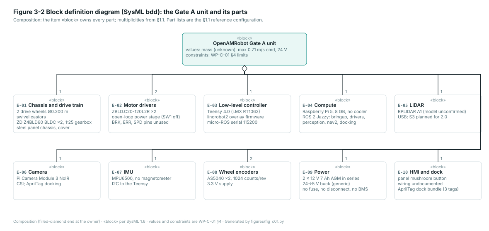
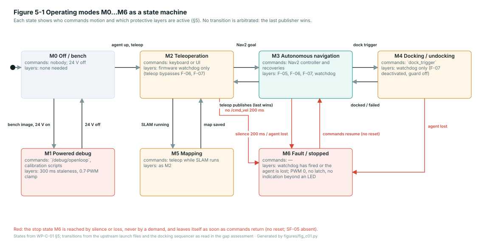

# WP-C-01 Item Definition and Limits of the Machinery

| Field | Value |
|---|---|
| Work product | WP-C-01 Item definition and limits of the machinery |
| Standard reference | ISO 12100:2010 §5.3 (determination of the limits of the machinery), §5.4 (hazard identification inputs); ISO 3691-4:2023 §3, §4 (terms, operating zones); ISO 13849-1:2023 §4.5; Regulation (EU) 2023/1230 Annex III §1.1.2, Annex IV Part A (technical documentation) |
| Version | 0.4 (2026-10-20): DQ-004 B and DQ-020 A applied: the item is the base with the arms and lift on two configurations, CFG-001 (Gate A unit, software and firmware reference, bench only per DQ-011 C) and CFG-002 (2.0 mobile manipulator, hardware reference, unverified); §1.2, §2.2 F-12…F-16, §3.1a E-11…E-20, §3.3a IF-09…IF-15, §4.5, §5.1, AOU-08…AOU-10; Figure 3-4. 0.3: element and interface IDs; Figures 3-1 (context and boundary), 3-2 (bdd), 3-3 (ibd), 5-1 (modes). 0.2: DQ-002 and DQ-005 applied. 0.1: initial draft |
| Status | Draft |
| PL / scope | PL d target for the stop functions (DQ-005); the base with the arms and lift (DQ-004 B, 2026-10-20) on two configurations (DQ-020 A): CFG-001 Gate A unit, the software and firmware reference, bench only (DQ-011 C); CFG-002 the 2.0 mobile manipulator, the hardware reference, every value quoted from upstream and unverified |
| Author | Assurance team (AI-assisted draft, I0) |
| Reviewer(s) | TBD (I1) |
| Approver | Project lead |
| Baseline | BL-001 (`baselines.yaml`): upstream Gate A unit as inherited |

> [!WARNING]
> Draft prepared for engineering review. Values marked **(unknown)** are not stated anywhere in the upstream
> record and must be measured or decided before the risk assessment (WP-C-03) can be rated. Nothing here has
> been verified on the robot. Everything said about CFG-002 (§1.2, §3.1a, §3.3a, §4.5, §5.1) is quoted from
> upstream's decision register and 2.0 reference pages; no repository holds that design, so each row is a claim
> to verify when it does, never evidence (gap assessment §8).

## 1. Item identification

| Field | Value |
|---|---|
| Item | OpenAMRobot mobile manipulator: the differential-drive base with its lift column and two OpenArm 2.0 arms, on two configurations. **CFG-001**, the Gate A unit (§1.1): the base upstream has wired, flashed and driven, with its ROS 2 Jazzy stack and Teensy 4.0 motion firmware; the software and firmware reference, driven on the bench only with the wheels off the ground (DQ-011 C). **CFG-002**, the OpenAMRobot 2.0 mobile manipulator (§1.2): the hardware the safety case is about, decided upstream, not yet in any repository |
| Fork | `jherrodthomas/openamr-platform-{sw,hw,fw}` from `openAMRobot/*` at BL-001 |
| Product class | Mobile manipulator: a driverless industrial truck (ISO 3691-4 scope, with a load-handling device on CFG-002) carrying an industrial robot system of two arms (ISO 10218-2; collaborative application per ISO/TS 15066 only where WP-C-06 §4 proves it) and a lifting column for the arms and their load, not for persons (ISO 12100; Regulation (EU) 2023/1230 Annex III §4, to be checked). CFG-001 carries no arm or lift |
| Upstream designation | CFG-001: "Gate A unit (existing robot, v0.0.1)". CFG-002: "OpenAMRobot 2.0", Gate B base controller, due as v2.0.0-rc.1 on 20 November 2026 and v2.0.0 on 18 December 2026 (`RELEASE-MILESTONES`) |
| Manufacturer of record | Botshare LTD, Limassol, Cyprus, for upstream; the fork assigns no manufacturer and places no product on the market |

### 1.1 Reference configuration CFG-001, the Gate A unit

| Element | Value | Source |
|---|---|---|
| Chassis | Steel (EN 1.0114) panel chassis, plastic cover, two drive wheels and swivel castors (Blickle LPA-VSTH 35K; count not stated) | `hw: manufacturing/bom/mechanical-bom.md:39-40`, `BOM_specs_MMP.xlsx` |
| Drive | 2 × ZD Z4BLD60-24GN-30S BLDC, 60 W, 24 V, 1:25 gearbox, 120 rpm at the wheel; 2 × ZBLD.C20-120L2R drivers in open-loop power-stage mode | `hw: components-bom.md:29-35, 70`; `motors-drivers.md:54` |
| Wheels | ⌀ 0.200 m drive wheels (Blickle GEVN 200/30H7), track 0.46 m measured (CAD says 0.4075 m, wrong) | `hw: components-bom.md:50-52`; `fw: config/lino_base_config.h:78-79` |
| Encoders | 2 × AS5040 magnetic quadrature, 1024 counts per wheel revolution, 3.3 V | `hw: electrical/sensors/encoders.md` |
| Low-level controller | Teensy 4.0 (i.MX RT1062) running the linorobot2 overlay firmware, micro-ROS over USB serial at 115200 baud | `fw: README.md`; `config/lino_base_config.h:211` |
| Compute | Raspberry Pi 5, 8 GB, Ubuntu Server 24.04, ROS 2 Jazzy, no active cooler | `hw: README.md:44` |
| Sensors | RPLIDAR A1 2D LiDAR (USB; model "not formally confirmed"), Raspberry Pi Camera Module 3 NoIR (CSI), MPU6500 IMU (no magnetometer) | `hw: README.md:46-50`; `lidar.md:98` |
| Power | 2 × 12 V 7 Ah AGM lead-acid in series (24 V 7 Ah); generic 24→5 V buck for the Pi; AC/DC converter of unknown model fed from 230 V mains in parallel with the battery; no fuse, no disconnect, no BMS | `hw: power.md:32-37, 50-60`; `components-bom.md:22-24` |
| Emergency stop | None in the documented design (a mushroom button is fitted to the panel; what it switches is undocumented) | gap assessment GAP-01 |
| Software | `openamrobot_bringup`, `_drivers`, `_perception`, `_nav2` (Nav2: AMCL, smac planner, DWB + RotationShim, velocity_smoother, collision_monitor), `_docking` (AprilTag sequencer), `_description`, `_gazebo`; `openamrobot_control` is a placeholder | `sw: ros2/src/` |
| Operator interface | Browser UI (`openamrobot-ui`, separate repository) over rosbridge; keyboard teleop; the on-screen E-STOP is a software request | `sw: docs/real_robot/06_operator_ui.md` |

### 1.2 Reference configuration CFG-002, the 2.0 mobile manipulator (unverified)

Every row quotes upstream's register (`openAMRobot/.github/decisions.yaml`, entry in the source column) or its 2.0
reference pages (`openamrobot-docs/docs/reference/openamrobot-2/`); upstream's own rule is that nothing in them is
production readiness, a validated payload or safety certification.

| Element | Value (as decided upstream) | Source |
|---|---|---|
| Chassis | The existing 780 × 582 mm steel chassis with a 294 mm deck; complete robot at most 1700 mm high at full lift extension; mass to be weighed (F2S mass budget from CAD) | `ARM-MOUNT`; `mass-and-stability.md` |
| Drive | Two ZLTECH ZLLG80ASM250-L-B hub motors with brakes, 200 mm wheels, one ZLAC8015D V4.2 driver on CAN1 (CANopen); brake ratings and fail-safe behaviour pending supplier evidence; drive pair rated for 120 kg drivable mass | `DRIVETRAIN`; `mass-and-stability.md` |
| Base controller | STM32H723ZG (Gate B); go/no-go 6 November 2026, fallback the Teensy build of CFG-001; IMU ICM-42688-P | `BASE-CONTROLLER-GATES` |
| Compute | NVIDIA Jetson Orin NX 16 GB on a reComputer J401 carrier; the Raspberry Pi is legacy | `COMPUTE` |
| Sensors | RPLIDAR S3 (beam 222 mm above the floor, functional sensing, not a safety device); Orbbec Gemini 336L base camera; four MaxBotix MB7060 ultrasonic sensors (front and rear, 91 mm above the floor); two Benewake TF-Luna cliff sensors; ZED Mini head camera on the lift carriage; one camera per gripper. No safety-rated personnel detection is named | `hardware-architecture.md`; gap assessment §8 |
| Power | 8S1P EVE LF105 LiFePO4 pack with a Daly BMS on CAN2; F0 110 A Class T fuse and a lockable battery disconnect; the STM32 stops motion and locks on a BMS fault | `BATTERY-PLACEMENT`, `BMS-FAULTS`, `MAIN-PROTECTION` |
| Safety chain | Exactly two E-stops (base front Schneider XB4BS8445 with ZBE-102; chest button from the OpenArm kit), dual channel into a Pilz PNOZ s3 with monitored manual reset; K1, K2 Gigavac GX11CAC in series with linked NC auxiliaries in the reset loop; an E-stop cuts actuator power only (traction, both arms, lift) and engages the brakes; the Jetson and logic rails stay up | `SAFETY-PROCUREMENT`, `ESTOP-SCOPE` |
| Lift | DOLD Hexalift V4, 350 mm stroke, 800 N push, 18 mm/s, column 530 mm retracted and 880 mm extended, on a two-position base plate (centre, +50 mm); shoulder height 1000 to 1350 mm; lift motion only in the stowed or carry pose with the base stopped; written DOLD holding on E-stop and power loss is a release gate not yet passed | `LIFT` |
| Arms | Two OpenArm 2.0 arms with pinch grippers on CAN-FD, mounted on the lift carriage 180 mm ahead of the column axis at y ±31 mm (J1_A at x +0.240 or +0.290 m); payload 4.1 kg nominal, 6.0 kg peak including the end effector; drawer and door pulls up to 150 N at working height; reach, joint torques and force limits **(TBC: official OpenArm 2.0 description)** | `ARM-MOUNT`; `dark-store-simulation.md`; `mass-and-stability.md` |
| Speed | 1.5 m/s command ceiling, an analytical limit; the operating speed follows from the stability model and the stopping tests; obstacle detection must reach at least 0.9 m ahead at that speed; hold-and-move limits 0.05 m/s (drawer reversal) and 0.3 m/s (carrying) | `SPEED-CEILING`, `LIFT`; `mass-and-stability.md` |
| Software | The CFG-001 stack ported to the Jetson; `openamrobot-manipulation` (manipulation server, OpenArm 2.0 device package); `openamr-upperbody-{sw,fw,hw}` repositories that "establish component boundaries" only; an embodied-AI policy runtime (WP-C-09) | `upper-body.md`; gap assessment §8 |
| Operator interface | Getac ZX10 detachable tablet, "non-authoritative; no actuation path" | `hardware-architecture.md` |

## 2. Intended use and functions

### 2.1 Intended use (ISO 12100 §5.3.2)

- **Use:** indoor transport of a payload on the top mounting plate between operator-defined goal poses in a mapped
  area, with autonomous navigation, obstacle avoidance and automatic docking to a charging/parking dock. Upstream
  positions the platform for "logistics and warehouse robotics" at SMEs and for research. On CFG-002 the robot
  also picks, places and carries items with its two arms at stations (dark-store shelving in upstream's
  simulation), pulls drawers and doors up to 150 N, and raises its arms between shoulder heights of 1000 and
  1350 mm with the lift; carrying is done in a carry pose at up to 0.3 m/s (upstream `LIFT` hold-and-move limits).
- **Users:** builders (assemble and wire from the open-source record), integrators (commission on a site),
  operators (send goals, monitor, stop), bystanders (share the floor). Upstream's own user page addresses "anyone
  who works near the robot, whether or not they operate it".
- **Level of training:** none assumed by upstream beyond its documentation; the fork assumes a trained operator
  present during every run until WP-C-03 says otherwise (AOU-01).
- **Modes of use foreseen by the record:** manual bench test (wheels off the ground), keyboard teleoperation,
  autonomous navigation to a goal, autonomous docking and undocking, mapping (SLAM), simulation.

### 2.2 Functions

| ID | Function | Implemented by | Notes |
|---|---|---|---|
| F-01 | Accept a velocity command and drive the wheels in closed loop | Teensy firmware: feedforward + PID per wheel at 50 Hz | Last stage before the motors |
| F-02 | Stop the wheels when commands cease | Firmware 200 ms `/cmd_vel` watchdog → PWM 0 (coast) | Functional, not a safety function (upstream register) |
| F-03 | Estimate wheel odometry and publish IMU data | Firmware; EKF on the Pi | |
| F-04 | Localise on a map and plan a path to a goal | AMCL, smac planner | |
| F-05 | Follow the path, avoiding mapped and seen obstacles | DWB controller with footprint critic; local costmap from the LiDAR | Objects below the scan plane are not seen |
| F-06 | Clamp commanded velocity and acceleration | velocity_smoother (open loop) | 0.20 m/s, 0.5 rad/s, ±1.0 / −2.5 m/s² |
| F-07 | Slow before a projected footprint collision | collision_monitor, one `approach` polygon on the live scan | Deactivated during docking |
| F-08 | Recover when stuck (spin, back up, drive on heading, wait) | Nav2 behavior_server, routed through F-06 and F-07 since #35 | Back-up on a rear-blind robot |
| F-09 | Dock to and undock from an AprilTag dock | `dock_trigger` sequencer publishing `/cmd_vel` directly | Bypasses F-06 and F-07; undock is a blind reverse |
| F-10 | Accept goals, teleoperation and a stop request from the operator UI | rosbridge, Flask UI | Unauthenticated |
| F-11 | Build a map | slam_toolbox | |
| F-12 | Plan and execute arm motion to pick, place, pull and hand over (CFG-002) | `openamrobot-manipulation` server, OpenArm 2.0 device package, CAN-FD to the arms | not in any platform repository; arm reach and force limits TBC |
| F-13 | Grip and release (CFG-002) | OpenArm pinch gripper; one wrist camera per gripper | load drop on gripper or power loss is a hazard input (H-14) |
| F-14 | Raise and lower the arms and their load between calibrated stops (CFG-002) | DOLD Hexalift V4 on the CAN3 lift interface, STM32 base controller | upstream rule: only in the stowed or carry pose with the base stopped |
| F-15 | Perceive the workspace for manipulation (CFG-002) | ZED Mini head camera, wrist cameras, Gemini 336L | functional sensing; nothing safety-rated |
| F-16 | Learned policy for manipulation and navigation (CFG-002, "embodied-AI runtime") | Jetson Orin NX | a learned component; no safety function is allocated to it (WP-C-09, IX-03) |

### 2.3 Functions the item does not provide (and the record says so)

Emergency stop, protective stop on personnel detection, safely-limited speed monitored independently of the
command path, holding brake, battery protection, authenticated command path. See the gap assessment. On CFG-002
the chain of §1.2 is decided but not built, and nothing upstream names a personnel-detection device, a speed
monitor, an arm safe stop, power-and-force limiting for the arms, or the lift's holding evidence.

## 3. Item boundary

### 3.1 Inside the item

| Element | Name and content | Role |
|---|---|---|
| E-01 | Chassis and drive train: steel panel chassis, cover, two Ø0.200 m drive wheels, swivel castors, 2 × ZD Z4BLD60 BLDC with 1:25 gearbox | mechanical, actuation |
| E-02 | Motor drivers: 2 × ZBLD.C20-120L2R in open-loop power-stage mode | last electrical stage before the motors |
| E-03 | Low-level controller: Teensy 4.0 with the linorobot2 overlay firmware (velocity loop, watchdog, odometry) | the only thing between a command and the motors |
| E-04 | Compute: Raspberry Pi 5 with the ROS 2 Jazzy stack (bringup, drivers, perception, nav2, docking) | navigation, docking, operator interface endpoint |
| E-05 | LiDAR: RPLIDAR A1 (model not formally confirmed) | functional sensing, not a safety device |
| E-06 | Camera: Raspberry Pi Camera Module 3 NoIR | AprilTag docking |
| E-07 | IMU: MPU6500, no magnetometer | odometry fusion |
| E-08 | Wheel encoders: 2 × AS5040, 1024 counts per revolution | velocity feedback, odometry |
| E-09 | Power: 2 × 12 V 7 Ah AGM in series, 24→5 V buck, the mains converter as installed, no fuse, no disconnect, no BMS | traction and logic supply |
| E-10 | HMI and dock: the panel E-stop button as fitted (wiring undocumented), status LED, the dock's AprilTag bundle | operator and site fixtures inside the boundary |

*Figure 3-1.* The item boundary (dashed) with the elements of this table and the external actors of §3.2; each connector carries an interface ID of §3.3. Data flows are grey, power amber; the E-stop button is drawn red because the as-built record does not say what it switches (GAP-01). Generated by [`figures/fig_c01.py`](figures/fig_c01.py) from §3.1, §3.2 and §3.3; CI fails if it is stale.

*Figure 3-2.* The block definition diagram (SysML bdd): the item as one block that owns every element by composition, with the parts of §1.1 and the multiplicities. Values and constraints are the limits of §4. Generated by [`figures/fig_c01.py`](figures/fig_c01.py); CI fails if it is stale.

*Figure 3-3.* The internal block diagram (SysML ibd): parts, ports and item flows, every connector labelled with its §3.3 interface. The grey dashed connectors are driver pins that exist and are not wired (`ERR/DO1`, `SPD/DO2`, `BRK/DI5`; GAP-04); the red dashed one is the E-stop button (GAP-01). Generated by [`figures/fig_c01.py`](figures/fig_c01.py); CI fails if it is stale.

### 3.1a Elements of CFG-002 (unverified)

| Element | Name and content | Role |
|---|---|---|
| E-11 | 2.0 base chassis and drive: the 780 × 582 mm chassis, two ZLTECH hub motors with brakes, ZLAC8015D driver on CAN1 | mechanical, actuation, braking |
| E-12 | Base controller: STM32H723ZG with its firmware (Gate B), ICM-42688-P IMU, near-field sensor UARTs | last stage before the drive, lift and brakes |
| E-13 | Compute: NVIDIA Jetson Orin NX with the ROS 2 stack, the manipulation server and the policy runtime | navigation, manipulation, operator endpoint |
| E-14 | Navigation and near-field sensing: RPLIDAR S3, Orbbec Gemini 336L, four MB7060 ultrasonic, two TF-Luna cliff sensors | functional sensing, not safety devices |
| E-15 | Power: 8S LiFePO4 pack, Daly BMS on CAN2, F0 110 A fuse, lockable disconnect, regulated 24 V and 5 V rails | traction, actuator and logic supply |
| E-16 | Safety chain: two E-stops, Pilz PNOZ s3, K1 and K2 Gigavac GX11CAC, reset button with lamp; actuator-power removal for traction, arms and lift | the only hardwired stop |
| E-17 | Lift: DOLD Hexalift V4 350 mm column on the two-position base plate, CAN3 interface | raises the arms and their load |
| E-18 | Arms: two OpenArm 2.0 with pinch grippers and wrist cameras, CAN-FD | manipulation |
| E-19 | Head camera: ZED Mini on the lift carriage | manipulation perception |
| E-20 | Operator panel: Getac ZX10 tablet, no actuation path; the dock | operator and site fixtures |

*Figure 3-4.* CFG-002 as upstream has decided it. The hatched boundary says what the table says: every element is a plan-set claim, not a part that exists. The arms and the lift bring the external actors "items at a station" and "a person within arm reach" that CFG-001 never had. Generated by [`figures/fig_c01.py`](figures/fig_c01.py) from §3.1a; CI fails if it is stale.

### 3.2 Outside the item

The site (floor, slopes, doors, lighting, people, other vehicles), the Wi-Fi network and the operator's computer,
tablet or phone, the browser UI (assessed only at its interface), the mains supply and charger installation, the
payload and its restraint, the items, shelves, drawers and doors the arms act on at a station, the fleet server.
The OpenArm body (`openarm_body_link0`) is not part of the robot (upstream `ARM-MOUNT`).

### 3.3 Interfaces

| ID | Interface | Direction | Content | Integrity today |
|---|---|---|---|---|
| IF-01 | `/cmd_vel` (DDS → serial → firmware) | in | `geometry_msgs/Twist`, no header | No authentication, no sequence, no validity check; any publisher |
| IF-02 | `/debug/openloop`, `/debug/tune`, `/debug/enc_cal` | in | raw PWM, PID gains, encoder table | Same; `openloop` gated by a compile-time define that is on |
| IF-03 | `/odom/unfiltered`, `/imu/data_raw`, `/debug/*` | out | odometry, IMU, telemetry | Best effort |
| IF-04 | `/scan` → `/scan_filtered` | in | LiDAR, body-filtered | 1 s source timeout in the monitor; rear sector removed |
| IF-05 | `/goal_pose`, `/dock_trigger`, `/undock_robot`, lifecycle services | in | goals, dock commands, node state | Any DDS participant on domain 0 |
| IF-06 | Teensy PWM / FWD / REV → ZBLD drivers | out | 3 kHz PWM speed setpoint, direction | Driver BRK and ERR pins unwired |
| IF-07 | 24 V bus | power | battery ∥ mains to drivers and buck | No fuse, no disconnect |
| IF-08 | USB 5 V (Pi → Teensy) | power | logic supply for the firmware | Pi brown-out removes the controller while drivers stay live |

### 3.3a Interfaces of CFG-002 (unverified)

| ID | Interface | Direction | Content | Integrity as decided |
|---|---|---|---|---|
| IF-09 | CAN1: base controller ↔ ZLAC8015D driver | out/in | CANopen velocity, brake release, driver status | STO input of the driver unknown (gap assessment §8) |
| IF-10 | CAN2: BMS ↔ base controller | in | cell voltages, faults; "stops motion and locks" on a hard fault | functional (upstream `BMS-FAULTS`) |
| IF-11 | CAN3: lift ↔ base controller | out/in | position between calibrated stops, holding | holding on E-stop and power loss is a release gate, unverified |
| IF-12 | CAN-FD: Jetson ↔ arms | out/in | joint commands, gripper, joint states | no force limit, no safe-torque-off named |
| IF-13 | Safety chain I/O: PNOZ s3 outputs → K1, K2 (traction, arms, lift actuator power); E-stop spare NO and RESET NC as diagnostic inputs through an ISO1212 into the STM32 | out, diag. in | actuator power removal; chain state for reporting | hardwired; diagnostics informative only (`SAFETY-CHAIN-IO`) |
| IF-14 | Jetson ↔ STM32 link | out/in | velocity commands, lift commands, odometry, near-field sensor data | the 2.0 counterpart of IF-01 and IF-03; protocol not public |
| IF-15 | Operator tablet (Getac ZX10) | in/out | goals, monitoring | "no actuation path" per upstream; to be verified |

## 4. Limits of the machinery (ISO 12100 §5.3)

### 4.1 Use limits

| Limit | Value | Status | Source |
|---|---|---|---|
| Maximum commanded speed (navigation) | 0.20 m/s forward, 0.05 m/s reverse, 0.5 rad/s | configured | `sw: nav2_params.yaml:116-120` |
| Maximum commanded speed (docking) | `drive_speed`, `final_push_speed` parameters, unbounded; undock 0.10 m/s | configured | `sw: dock_trigger.yaml:22-23`; `dock_trigger.py:1370, 1641` |
| Firmware speed ceiling | 68 rpm ≈ 0.71 m/s (software clamp in kinematics) | configured | `fw: config/lino_base_config.h:69-70` |
| Mechanical maximum | 120 rpm ≈ 1.26 m/s no-load | by design | `hw: components-bom.md:54` |
| Minimum reliable speed | 0.04 m/s linear, 0.15 rad/s angular (stick-slip floor; below it motion is unpredictable) | measured 2026-07-02 | `fw: docs/safety/motion-safety.md` |
| Acceleration / deceleration | +1.0 / −2.5 m/s² linear, +3.0 / −3.0 rad/s² angular (commanded) | configured | `sw: nav2_params.yaml:124-131` |
| Stopping distance from 0.20 m/s | **(unknown)**; coast after PWM 0, never measured | — | GAP-02 |
| Payload | **(unknown)**; motor sizing example uses 45 kg total | — | `hw: datasheets/motor-sizing-calculations.md:209` |
| Robot mass | **(unknown)**; to be weighed | — | GAP-23 |
| Centre of gravity, tipping margin | **(unknown)** | — | GAP-23 |
| Slope | **(unknown)**; sizing example assumes 10°; castors stop on small steps | — | `motor-sizing-calculations.md:209`; `docs: mass-and-stability.md` |
| Floor | flat indoor floors; thresholds and cable covers at crawl speed (2.0 statement, applied here as an assumption) | assumed | `docs: reference/openamrobot-2/mass-and-stability.md` |
| Battery | ≥ 25 V at rest before any navigation test; below ~22 V under load the drivers under-volt and the robot fails to follow | operational rule | `sw: docs/safety/02_limits_and_watchdog.md` §4 |
| Endurance | 24 V 7 Ah; runtime **(unknown)** | — | |

### 4.2 Space limits

| Limit | Value | Source |
|---|---|---|
| Footprint (navigation polygon) | 0.805 m long (0.415 m ahead of `base_link`, 0.390 m behind) × 0.58 m wide, chamfered corners | `sw: nav2_params.yaml:172` |
| Height | **(unknown)** for the base; 2.0 complete robot ≤ 1700 mm at full lift | `docs: mass-and-stability.md` |
| Sensing plane | LiDAR 0.18 m above the floor (A1, Gate A unit mounted rotated 180°); S3 at 0.222 m for 2.0 | `sw: docs/navigation/01_architecture.md:122`; `hw: lidar.md:20` |
| Sensing coverage | forward and sides; rear sector [−45°, 49°] in the LiDAR frame removed; side returns < 0.40 m removed in two sectors | `sw: scan_body_filter_real.yaml:28-32` |
| Operating area | a mapped indoor area the operator has walked; the dock approach lane and the 0.7 m behind a docked robot are blind zones | `docs: use/monitoring/safety.md` |
| Reach of the operator | the physical stop (none) and the on-screen stop (software) | GAP-01, GAP-28 |

### 4.3 Time limits

| Limit | Value | Source |
|---|---|---|
| Command watchdog | 200 ms without `/cmd_vel` → PWM 0 | `fw: src/firmware.ino:611` |
| Velocity smoother timeout | 1.0 s without input → ramp to zero | `sw: nav2_params.yaml:348` |
| Collision monitor source timeout | 1.0 s stale scan tolerated | `nav2_params.yaml:358` |
| Agent ping | every 200 ms; loss → full stop | `fw: src/firmware.ino:280-289` |
| Lifecycle bond timeout | 60 s | `sw: navigation_launch.py:237` |
| Service life, maintenance intervals | **(unknown)**; upstream docs list daily/weekly/monthly checks as templates | `docs: maintain/routine/` |

### 4.4 Other limits

Indoor use only (IP rating unknown, motors IP20). Temperature range **(unknown)**; the Pi throttles at ~83 °C
without a cooler. Lighting: AprilTag docking needs the tags visible to the camera. Noise and EMC: not assessed.

### 4.5 Limits of CFG-002 (quoted, unverified)

| Limit | Value as decided upstream | Source |
|---|---|---|
| Command ceiling | 1.5 m/s in software, an analytical limit; the accepted operating speed waits for the stability model and the stopping tests | `SPEED-CEILING` |
| Carrying and hold-and-move | 0.3 m/s carrying in the carry pose; 0.05 m/s drawer reversal | `LIFT` |
| Obstacle detection | must reach at least 0.9 m ahead at the ceiling speed (functional sensing) | `mass-and-stability.md` |
| Footprint and height | 780 × 582 mm chassis; at most 1700 mm high at full lift extension; arm mount points at x +0.240 or +0.290 m from `base_link`, y ±31 mm | `ARM-MOUNT`; 2.0 index page |
| Mass | to be weighed; drive pair rated for 120 kg drivable mass; the F2S model is "static and quasi-static on flat floors" and "makes no safety claim" | `mass-and-stability.md` |
| Arm payload and pulls | 4.1 kg nominal, 6.0 kg peak including the end effector; drawer and door pulls up to 150 N at working height with the hands close to the body | `dark-store-simulation.md`; `mass-and-stability.md` |
| Arm reach, joint torque, contact force | **(TBC: official OpenArm 2.0 description; not quoted upstream)** | — |
| Lift | 350 mm stroke, 800 N push, 18 mm/s; shoulder 1000 to 1350 mm; motion only in the stowed or carry pose with the base stopped | `LIFT` |
| Floor and thresholds | flat indoor floors; thresholds and cable covers at crawl speed; the 35 mm castors stop on small steps | `mass-and-stability.md` |
| Stopping distance, tipping margins | from the stopping tests and the F2S rerun, both pending | `mass-and-stability.md` |

## 5. Operating modes and states

| Mode | Who commands motion | Protective layers active | Notes |
|---|---|---|---|
| M0 Off / bench | nobody; 24 V off | none needed | Wheels off the ground for all first tests (upstream rule) |
| M1 Powered debug | `/debug/openloop`, calibration scripts | 300 ms staleness, 0.7·PWM clamp | Robot must be on blocks; path enabled in the deployed build |
| M2 Teleoperation | keyboard or UI | firmware watchdog only (teleop bypasses F-06, F-07) | No deadman |
| M3 Autonomous navigation | Nav2 controller and recoveries | F-05, F-06, F-07, watchdog | |
| M4 Docking / undocking | `dock_trigger` | watchdog only (F-07 deactivated, guard off) | Blind final approach and reverse |
| M5 Mapping | teleop while SLAM runs | as M2 | |
| M6 Fault / stopped | — | watchdog has fired or the agent is lost; PWM 0, no latch, no indication beyond an LED | Resumes as soon as commands return |

Transitions between M2, M3 and M4 are not arbitrated: whoever publishes last wins (GAP-36).

*Figure 5-1.* The modes of the table as one state machine. Transitions come from the upstream launch files and the docking sequencer as read in the gap assessment; none is arbitrated. M6 is red because it is entered by silence or loss, never by a demand, and is left without a reset (SF-05 absent). Generated by [`figures/fig_c01.py`](figures/fig_c01.py); CI fails if it is stale.

### 5.1 Additional modes on CFG-002 (planned, unverified)

| Mode | Who commands motion | Protective layers planned | Notes |
|---|---|---|---|
| M7 Manipulation | the manipulation server or the policy runtime moves an arm; the base is stopped | the chain removes arm power on an E-stop; nothing else named | people within arm reach are the collaborative-operation question of WP-C-06 §4 |
| M8 Lift motion | the base controller moves the lift between calibrated stops; arms in the stowed or carry pose; base stopped | lift holding on E-stop and power loss (release gate) | crushing and shearing at the column and under the arms |
| M9 Carrying | Nav2 drives the base at up to 0.3 m/s with the arms in the carry pose holding a load | the chain; the speed and stability limits of §4.5 | the arms raise the centre of gravity and widen the footprint |

Transitions between M7, M8 and M9 and the base modes M2–M4 are rules upstream has written (lift only with the base
stopped; carrying only in the carry pose), not interlocks any repository implements. WP-C-04 SF-10 is the function
that makes them so.

## 6. Legal requirements and standards

| Instrument | Applies because | Status in the record |
|---|---|---|
| Regulation (EU) 2023/1230 (Machinery), from 20 January 2027; Directive 2006/42/EC until then | a self-propelled machine placed on the EU market (upstream sells kits from Cyprus) | no conformity file, no declaration; the fork places nothing on the market |
| ISO 3691-4:2023 | driverless industrial truck in zones shared with people | not cited anywhere upstream |
| ISO 10218-2:2025, ISO/TS 15066:2016 | the arms as an industrial robot system; collaborative operation (power-and-force limiting, speed-and-separation monitoring) on CFG-002 | not cited; the OpenArm 2.0 limits are not quoted upstream |
| ISO 12100 §6, Regulation (EU) 2023/1230 Annex III §4 (lifting operations, to be checked) | the lift carries the arms and their load, never persons | not cited |
| ISO 13849-1:2023 / -2:2012 | safety-related parts of the control system | not cited; no PL claimed |
| EN 60204-1:2018, ISO 13850:2015 | electrical equipment, emergency stop | E-stop parts cited to IEC 60947-5-5 only |
| ISO 12100:2010 | risk assessment | upstream asks the user to do it |
| IEC 62443-4-1/-4-2 | networked industrial control | not cited |
| Regulation (EU) 2024/1689 (AI Act) Annex I | when the learned policy (2.0 embodied-AI runtime) becomes a safety component | no safety function is allocated to it (WP-C-09); the AI Act record is WP-K-07 |
| ANSI/A3 R15.08-1 | if deployed in the US (DQ-003) | not cited |

## 7. Known hazards and experience from similar items

- Upstream field notes: an unresolved intermittent left-wheel dropout (loose power or motor connector); the LiDAR
  "sometimes stops publishing on its own"; the Pi freezing on a bring-up current spike; a right wheel that "ran
  away" at 8× speed from a driver potentiometer setting before the open-loop configuration was adopted; docking
  aborts from self-view false positives that led to the guard being switched off.
- Industry experience for AMRs of this class (ISO 3691-4 Annex A hazards): collision with a person in the path or
  reversing, crushing against fixed structures, tipping on ramps or with a high payload, run-away on loss of
  control, unexpected start-up after a stop, electrical fire from an unfused traction battery.
- Industry experience for mobile manipulators and collaborative arms (ISO 10218-2 Annex A, ISO/TS 15066): impact
  and clamping by an arm at head and hand height, a dropped or thrown load, an arm sweep that widens the footprint
  the base's detection was sized for, crushing and shearing at a lift column, tipping with an arm extended, and
  the base moving while an arm is outside its stowed pose. Upstream's F2S model already analyses the arm-forward
  and one-arm-sideways poses and a 150 N pull for tipping.

## 8. Assumptions of use and external measures

| ID | Assumption | Holds today? | Where it is used |
|---|---|---|---|
| AOU-01 | A trained operator is present, watching the robot (not the screen), with the means to cut 24 V by hand, for every powered run | partly: upstream instructs it; no hardware disconnect exists | every hazard in WP-C-03 until SF-01 exists |
| AOU-02 | The operating area is clear of people during autonomous navigation, docking and undocking | procedural only | H-01, H-02 |
| AOU-03 | Wheels are off the ground whenever a powered debug path or calibration runs | procedural only; no interlock | H-04 |
| AOU-04 | The battery is ≥ 25 V at rest before a run | procedural only; no measurement | H-03 |
| AOU-05 | The Wi-Fi network carrying DDS is private and reaches only trusted hosts | not stated; a guest SSID is named in the docs | H-05 |
| AOU-06 | The floor is flat, dry, indoor, free of steps above the castor limit | assumed | H-06 |
| AOU-07 | The payload is restrained and within a mass and height limit **(to be set)** | no limit stated | H-06 |
| AOU-08 | The base does not move while an arm is outside its stowed or carry pose (CFG-002; WP-C-06 CA-01) | planned upstream (`LIFT` motion rules); no interlock in any repository | H-01, H-13, H-15 |
| AOU-09 | The lift moves only in the stowed or carry pose with the base stopped, and holds its load on an E-stop and on power loss (CFG-002) | planned upstream; the DOLD holding evidence is a release gate not yet passed | H-14, H-15 |
| AOU-10 | Nobody is within reach of an arm while it moves, until its power-and-force limiting is measured against ISO/TS 15066 (CFG-002) | procedural only; no arm exists on CFG-001 | H-13 |

## 9. Out of scope for this item

The fleet server; the OpenArm body and any OpenArm configuration other than the two arms on the lift carriage;
the learned policy as a safety function (it is inside the item as F-16 and outside every safety function, WP-C-09);
OpenAMRobot 3.0. Until v0.3 the whole 2.0 design was out of scope; from v0.4 it is CFG-002 (DQ-004 B, DQ-020 A).

## 10. Open items

| ID | Item | Needed by |
|---|---|---|
| OI-1 | Weigh the Gate A unit; measure height; record castor count and positions | WP-C-03 risk estimation (tipping, crushing) |
| OI-2 | Measure stopping distance from 0.20 m/s on the watchdog coast and on a commanded −2.5 m/s² stop, loaded and unloaded | WP-C-03, SF-02 field sizing |
| OI-3 | Set a payload limit and a payload height limit | AOU-07 |
| OI-4 | Resolve what the panel E-stop button switches on the as-built unit | GAP-01, SF-01 |
| OI-5 | ~~Decide the regulatory frame (DQ-003) and the item scope (DQ-004)~~ both decided 2026-10-20 and applied in v0.4 (EU frame; the base with the arms and lift on CFG-001 and CFG-002, DQ-020 A) | closed |
| OI-6 | Obtain the OpenArm 2.0 reach and stopping distance from the official description and record them in §4.5 (the contact-force limits are not needed for the claim since DQ-021 A) | WP-C-03 H-13, WP-C-06 CA-02 |
| OI-7 | Replace every CFG-002 row by a verified value as the 2.0 repositories and drawings become public (v2.0.0-rc.1, 20 November 2026) | every CFG-002 claim |
