# WP-C-03 Annex A High-Risk Hazard Sheets

<!-- Generated by assurance/02-concept/figures/fig_c03.py from WP-C-03, WP-C-05 and the review renders; do not edit by hand. -->

| Field | Value |
|---|---|
| Work product | Annex A of [WP-C-03](WP-C-03-risk-assessment.md) Risk assessment; not a separate work product |
| Version | Follows WP-C-03 v0.7: generated from its tables at every change |
| Status | Draft, as WP-C-03 |
| Content | One sheet per high-risk row of WP-C-03 §5: adopted PLr d, or e and excluded, or d on the risk graph with no control function |

> [!NOTE]
> A view of the record, not a second record. Every value comes from WP-C-03 §4, §5, §6 and §9 and WP-C-05 §5;
> change it there and run `figures/fig_c03.py`. The pictures are review renders of the simulation track: synthetic,
> pictures only, no evidence credit. A picture shows the situation; the sheet under it says what would stop it and
> what exists today.

12 rows are high risk; 12 of them have a review picture.

## A.1 What to build first

*Figure A-1.* Every high-risk row waits on at least one measure with nothing on any build; the column counts rank the measures by how many of these rows they unblock.

## A.2 The sheets

### A.2.1 H-01 · aisle, staff crossing or walking beside the robot

*Review picture* `openamrobot-m-aisle.jpg`: synthetic, no evidence credit ([the render set](../sim/blender/README.md#1-the-renders)).

### A.2.2 H-01 · aisle, blind corner

*Review picture* `openamrobot-m-corner.jpg`: synthetic, no evidence credit ([the render set](../sim/blender/README.md#1-the-renders)).

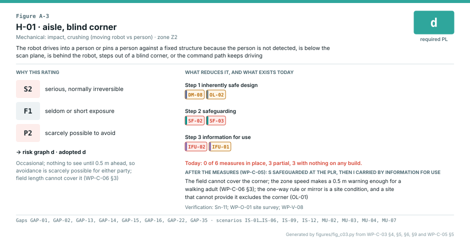

### A.2.3 H-01 · dock lane, docking and reverse

*Review picture* `openamrobot-undock.jpg`: synthetic, no evidence credit ([the render set](../sim/blender/README.md#1-the-renders)).

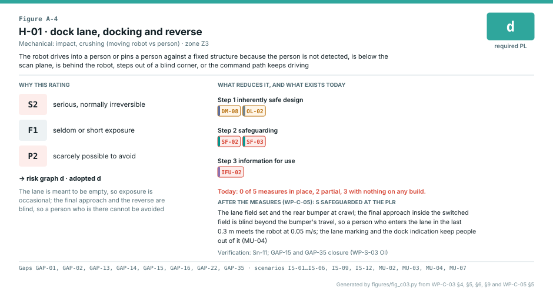

### A.2.4 H-01 · public floor

*Review picture* `openamrobot-m-public.jpg`: synthetic, no evidence credit ([the render set](../sim/blender/README.md#1-the-renders)).

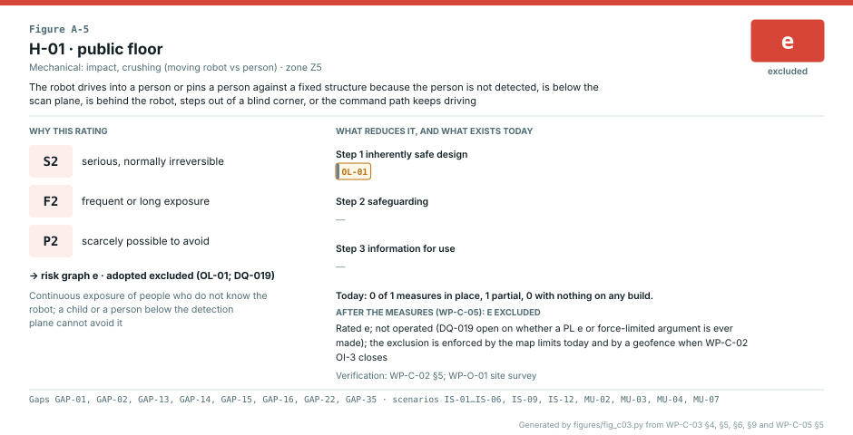

### A.2.5 H-02 · uncommanded motion near people

*Review picture* `openamrobot-m-uncommanded.jpg`: synthetic, no evidence credit ([the render set](../sim/blender/README.md#1-the-renders)).

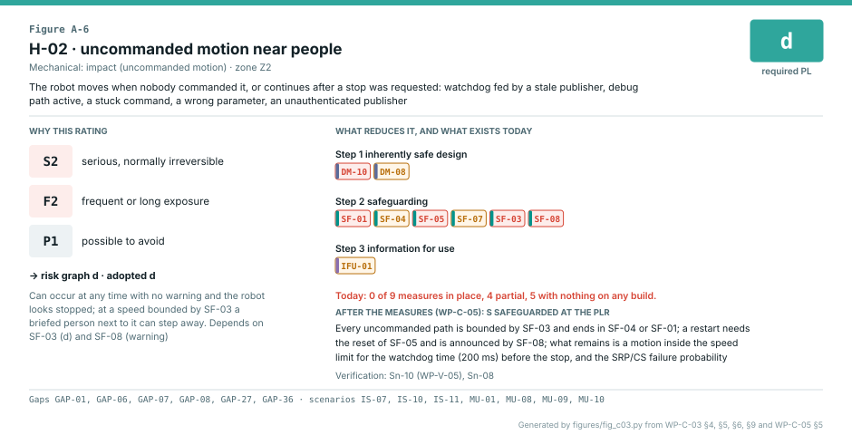

### A.2.6 H-05 · restart after a chain, fault or watchdog stop

*Review picture* `openamrobot-m-restart.jpg`: synthetic, no evidence credit ([the render set](../sim/blender/README.md#1-the-renders)).

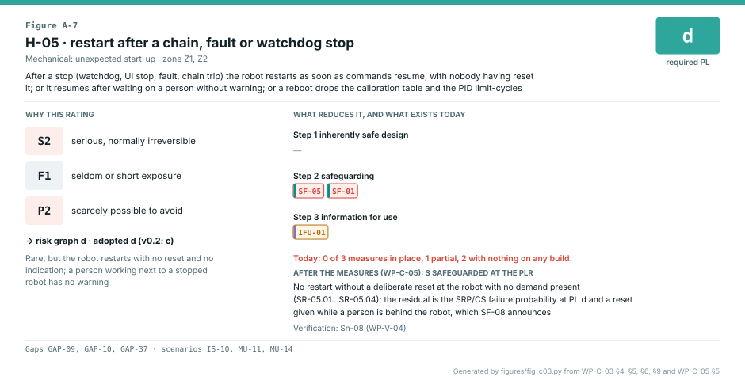

### A.2.7 H-05 · resume after waiting on a person

*Review picture* `openamrobot-m-resume.jpg`: synthetic, no evidence credit ([the render set](../sim/blender/README.md#1-the-renders)).

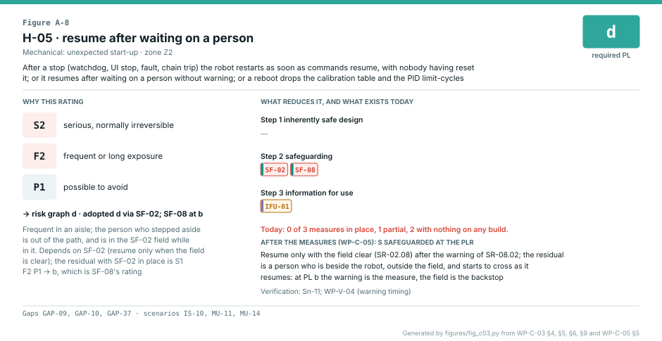

### A.2.8 H-07 · electrical fire

*Review picture* `openamrobot-fire.jpg`: synthetic, no evidence credit ([the render set](../sim/blender/README.md#1-the-renders)).

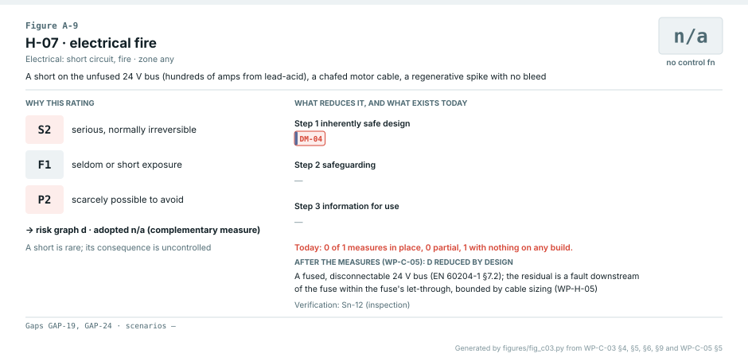

### A.2.9 H-10 · mode confusion

*Review picture* `openamrobot-m-mode.jpg`: synthetic, no evidence credit ([the render set](../sim/blender/README.md#1-the-renders)).

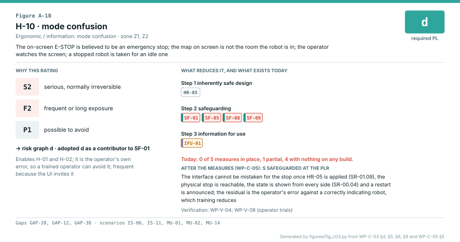

### A.2.10 H-13 · arm contact at a station

*Review picture* `openamrobot-m-station.jpg`: synthetic, no evidence credit ([the render set](../sim/blender/README.md#1-the-renders)).

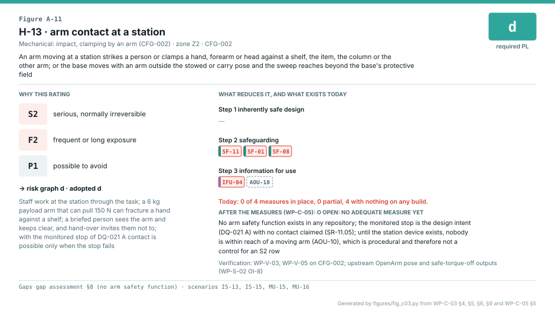

### A.2.11 H-13 · base moves with an arm extended

*Review picture* `openamrobot-m-carry.jpg`: synthetic, no evidence credit ([the render set](../sim/blender/README.md#1-the-renders)).

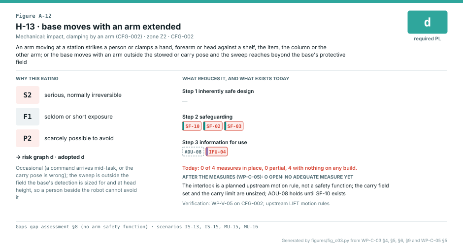

### A.2.12 H-14 · load drops from the gripper or the lift

*Review picture* `openamrobot-m-drop.jpg`: synthetic, no evidence credit ([the render set](../sim/blender/README.md#1-the-renders)).

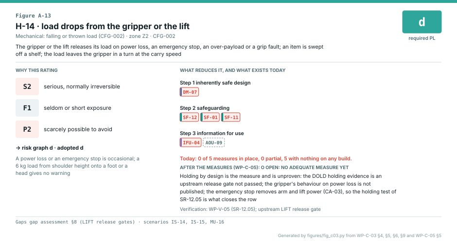

## A.3 How the sheets are made

`figures/fig_c03.py` selects the high-risk rows of WP-C-03 §5 and draws one sheet each from §4 (the event), §5 (the
ratings and their rationale), §6 (the state of each measure), §9 (gaps and scenarios) and WP-C-05 §5 (the measures
per step, the residual class, the verification). CI fails if a sheet is stale, if a §5 row has no WP-C-05 row, if
WP-C-05 names a measure §6 does not register or if a measure has no state.
