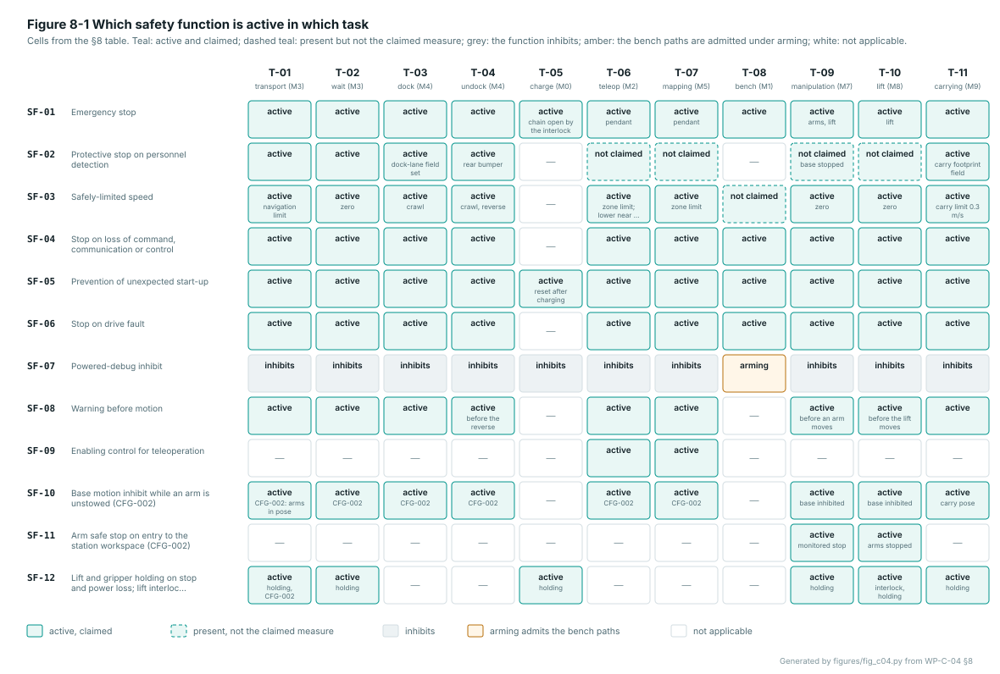

# WP-C-04 Safety functions specification with required Performance Level, stop category and response time

| Field | Value |
|---|---|
| Work product | WP-C-04 Safety functions specification with required Performance Level, stop category and response time |
| Standard reference | Machinery: 3691-4 §4; 13850 §4; SRP/CS: 13849-1 §5, Annex A (PLr); Other: 60204-1 §9.2 (stop categories); ASPICE: SYS.2 |
| Version | 0.2 (2026-10-20): DQ-004 B, DQ-014 B and DQ-020 A applied: SF-10…SF-12 (arms and lift, CFG-002) specified; §5 allocation rewritten with the firmware as a channel of the SRP/CS for SF-03, SF-04 and SF-06; configuration stated per function; §8 tasks T-09…T-11. 0.1: SF-01…SF-09 specified (demand, safe state, response, stop category, modes and tasks); PLr derived from WP-C-03 v0.3 with the type-C check; allocation; response-time budget; task applicability; Figures 2-1, 7-1, 8-1. 0.0: skeleton |
| Status | Draft |
| PL / scope | PL d (SF-01, SF-02, SF-03, SF-05, SF-10, SF-11, SF-12), PL c (SF-04, SF-06, SF-09), PL b (SF-07, SF-08); CFG-001 Gate A unit (bench only) and CFG-002 2.0 mobile manipulator (unverified); SF-10…SF-12 exist only on CFG-002 |
| Author | Assurance team (AI-assisted draft, I0) |
| Reviewer(s) | TBD (I1) |
| Approver | Safety manager |
| Baseline | BL-001 |

> [!WARNING]
> Draft. The functions are specified at concept level from the hazards and ratings of WP-C-03 v0.3 and the
> scenarios of WP-C-06. The response-time figures are the budget of WP-H-02 §3.2 for the candidate parts, not
> measurements; every stopping distance is **(TBC)** until WP-V-02 measures it. The ISO 3691-4 Performance Levels
> quoted in §4 are from memory of the standard and are marked to be checked against a licensed copy (DQ-016,
> answered C: unscheduled). Version 0.2 applies the lead's answers of 2026-10-20: the firmware is a channel of the
> safety-related control system for SF-03, SF-04 and SF-06 (DQ-014 B, §5) and the arms and lift are in the item on
> CFG-002 (DQ-004 B, DQ-020 A; SF-10…SF-12). Every CFG-002 row rests on upstream's plan set. The stop category of
> SF-01 (DQ-015) is open; the planning assumption is marked. The collaborative mode of the arms is decided (DQ-021 A): a
> safety-rated monitored stop, no contact claimed.

## 1. Purpose

Specifies the safety functions of the machine (ISO 13849-1 §5): for each, the triggering condition, the safe
state, the response time, the stop category (EN 60204-1 §9.2), the required Performance Level from the risk
graph, and the operating modes it applies in. SF-nn IDs are never reused. The functions are identified in
[WP-C-03](WP-C-03-risk-assessment.md) §7; this document is their specification; [WP-S-02](../03-system/WP-S-02-safety-requirements.md)
breaks each into testable requirements SR-nn.mm; [WP-S-03](../03-system/WP-S-03-technical-safety-concept.md)
designs the safety-related parts that implement them; [WP-S-04](../03-system/WP-S-04-response-time-and-stopping-budget.md)
budgets the response times and stopping distances against measurement.

Conventions: a **demand** is the event the function must respond to; the **safe state** is what the function
achieves and holds; the **response time** runs from the demand at the sensor or device to the start of power
removal or the controlled stop, measured at the driver input (WP-S-02 §1); **standstill** adds the stopping time,
which is unmeasured. Stop categories per EN 60204-1 §9.2.2: category 0 is immediate removal of power (a coast on
the Gate A drive, which has no brake); category 1 is a controlled stop with power removed when stopped.

## 2. Safety functions

| ID | Safety function | Demand | Safe state | PLr | Cat. | Stop cat. | Response target | Hazards |
|---|---|---|---|---|---|---|---|---|
| SF-01 | Emergency stop | A person actuates any emergency-stop device on the robot or on the operator's pendant | Traction power removed by two independent paths; latched until a deliberate reset | d | 3 | 0 (planning assumption; DQ-015) | ≤ 200 ms to power removal | H-01, H-02, H-04, H-05, H-10 |
| SF-02 | Protective stop on personnel detection | A person or object enters the protective field in the direction of travel; the rear bumper is pressed; the detection device reports a fault or loses its field | Controlled stop, then power removed if standstill is not reached; motion resumes only with the field clear, and after a reset where power was removed | d | 3 | 1 then 0 | ≤ 170 ms to the start of the stop; standstill before contact, field sized per WP-C-06 §3 | H-01, H-05, H-11 |
| SF-03 | Safely-limited speed | The monitored wheel speed exceeds the limit of the active zone for more than 100 ms, or the robot moves in a direction not permitted at that speed (reverse above the crawl limit) | Controlled stop, then power removed if standstill is not reached; latched | d | 3 | 1 then 0 | detect ≤ 100 ms; ≤ 170 ms to the start of the stop | H-01, H-03, H-12 |
| SF-04 | Stop on loss of command, communication or control | No valid velocity command for 200 ms; the micro-ROS agent is lost; the safety-controller heartbeat is lost; the control loop hangs (hardware watchdog, 1 s) | Drives at zero; power removed and the stop latched when the cause is a fault | c | 2 | 0 | ≤ 200 ms (command); ≤ 1 s (loop hang) | H-02, H-11 |
| SF-05 | Prevention of unexpected start-up | Any stop that removed power (SF-01, SF-02, SF-03, SF-04 on a fault, SF-06), a power cycle, a reboot of the microcontroller | No motion until a deliberate reset at the robot with every demand cleared, followed by a fresh velocity command | d | 3 | — | reset accepted only after all demands are clear; no time limit |  H-05, H-02 |
| SF-06 | Stop on drive fault | A motor-driver fault output; a wheel driven hard that does not turn (stall, dead encoder); a following error between commanded and monitored speed; battery under-voltage | Both drives stopped, power removed, latched | c | 2 | 0 | ≤ 100 ms (fault input); ≤ 1 s (stall, following error) | H-03, H-01 |
| SF-07 | Powered-debug inhibit | A raw-PWM, gain or calibration command arrives on the reference image, or on a bench image without the physical arming input | The command is refused; the motors neither move nor retune; the image reports which it is | b | 1 | — | — (inhibit, not a stop) | H-04, H-02, H-12 |
| SF-08 | Warning before motion | Motion is about to start or resume: after a reset, after a protective stop or slow-down, after a wait on a person, before an undock reverse | An audible and visual warning for **(TBC: 2 s)** before the wheels turn, and a visible state on every side while slowed or stopped | b | 1 | — | warning ≥ **(TBC: 2 s)** before motion | H-05, H-10 |
| SF-09 | Enabling control for teleoperation | The hold-to-run control of the teleoperation device is released, or a teleoperation command arrives without it held | Drives at zero; no teleoperation motion without the control held; speed capped at the zone limit, lower within 2 m of a person (DQ-017) | c | 2 | 0 | ≤ 200 ms from release | H-01, H-10 |
| SF-10 | Base motion inhibit while an arm is unstowed (CFG-002) | A base motion command, or motion, while either arm is outside its stowed or carry pose, or while the "stowed or carry" signal is absent or invalid | Traction power not enabled, or removed within the response time; latched until the arms are back in pose and a reset where power was removed | d | 3 | 0 | ≤ 200 ms to power removal | H-13, H-15 |
| SF-11 | Arm safe stop on entry to the station workspace (CFG-002) | A person enters the station's marked workspace while an arm moves (safety-rated monitored stop, DQ-021 A); a hand-over is requested while the arm moves; an E-stop | The arm stops as a safety-rated monitored stop (safe torque off or safe stop with holding), the gripper holds; the arm resumes only on a deliberate action with the workspace clear; hand-over only with the arm stopped | d | 3 | 1 then 0 (arm) | ≤ 200 ms to the start of the stop **(TBC)** | H-13 |
| SF-12 | Lift and gripper holding on stop and power loss; lift interlock (CFG-002) | Any stop that removes actuator power, a power loss, an over-payload; or a lift motion command while the base moves, while an arm is outside the stowed or carry pose, or while the keep-clear zone under the carriage is occupied | The lift holds its position and the gripper holds its load without power; a lift command is refused unless the interlock conditions hold | d | 3 (holding: by design, DM-07) | — (holding) | holding from the instant of power removal; no drift beyond **(TBC: 5 mm)** | H-14, H-15 |

*Figure 2-1.* The twelve functions of the table as cards: demand on the left, safe state on the right, the four attributes a safety-requirements specification needs as badges. Generated by [`figures/fig_c04.py`](figures/fig_c04.py) from the §2 table; CI fails if it is stale.

## 3. Specification per function

Each function below carries the items ISO 13849-1 §5.1 expects of a safety requirements specification; the
requirements SR-nn.mm of WP-S-02 are the testable form. "Today" is the Gate A unit at BL-001.

### 3.1 SF-01 Emergency stop

| Item | Specification |
|---|---|
| Demand | A person actuates any emergency-stop device: the two devices on the robot (front panel; rear or top plate) or the pendant in the operator's hand during teleoperation and testing (ISO 13850 device: red mushroom on yellow, positive-opening contacts, latching) |
| Safe state | Traction power removed from both drivers by two independent paths (series contactors K1, K2 and the drivers' brake/inhibit input); the state latched until a deliberate reset at the robot (SF-05) |
| Response time | ≤ 200 ms to power removal (SR-01.03); the budget of WP-H-02 §3.2 is ≤ 50 ms |
| Stop category | **0** (planning assumption, DQ-015 queued): the robot coasts on the Gate A drive, so the stopping distance under category 0 is a measured input (WP-V-02); category 1 would put the firmware in the stop path, which DQ-014 argues against |
| PLr | d (§4) |
| Category, DC | 3, medium or better (dual channel, cross-monitored, contactor feedback in the reset loop) |
| Modes and tasks | Every mode M0–M6; every task (§8), including charging, where the chain is open anyway |
| Priority | Highest; overrides every other command and every other function; no software state delays it (SR-01.04) |
| Reset | Monitored manual reset (SR-01.06): release of every device **and** actuation and release of the reset; a held reset does not enable |
| Demand rate | Low: a few actuations a day in testing (B10d of the devices and contactors sized for ≤ 10 operations a day, WP-H-02 §4) |
| Fault reaction | A single fault in either channel, a welded contactor or a short to supply is detected at or before the next demand and prevents reset (SR-01.05, SR-01.07) |
| Interfaces | Inputs: the devices' two NC contacts each; output: contactor coils and driver `BRK/DI5`; diagnostic: chain state to the firmware (informative only) |
| Verification | WP-S-02 §11: each device, each channel open, welded-contact simulation, reset held; ISO 13849-2 fault list |
| Today | The panel button switches nothing (GAP-01); no pendant |

### 3.2 SF-02 Protective stop on personnel detection

| Item | Specification |
|---|---|
| Demand | A person or object enters the protective field of the front safety scanner in the direction of travel; the rear safety bumper is pressed while reversing; the scanner or the bumper monitor reports a fault, loses its field or goes stale (DQ-007: scanner plus rear bumper) |
| Safe state | Controlled stop within the stability limit of WP-C-01 §4.1 (stop category 1), power removed if standstill is not reached within **(TBC: 1 s)**; the robot resumes only when the field is clear and, where power was removed, after the reset of SF-05 (SR-02.05, SR-02.08) |
| Response time | ≤ 170 ms from the person entering the field to the start of the stop (scanner 70–100 ms, speed monitor 20 ms, relay and contactors 50 ms, WP-H-02 §3.2); standstill before contact: the field length L of WP-C-06 §3 absorbs the stopping distance, so the function's real requirement is `L ≥ v·t_r + d_b + K·(t_r + t_b) + Z + C` with d_b and t_b measured |
| Stop category | 1, then 0 if standstill is not reached |
| PLr | d (§4) |
| Category, DC | 3, medium or better; the scanner is a type 3 device per IEC 61496-3 with two OSSD outputs; the bumper a PL d pressure-sensitive edge with monitoring unit (ISO 13856-3) |
| Modes and tasks | M3 navigation (T-01, T-02), M4 docking and undocking (T-03 with the dock-lane field set, T-04 with the rear bumper), M2/M5 teleoperation and mapping (active, not claimed: the operator with SF-09 is the measure); not on the bench (§8) |
| Field sets | Navigation (1.0 m starting value) and dock lane / crawl (0.3 m at ≤ 0.05 m/s), selected by the speed monitor or a safe zone input, never by the ROS 2 stack (SR-02.07); detection from the floor to **(TBC: 0.3 m)** (HR-02) |
| Priority | Above every command and every functional layer; the collision monitor and the costmap are functional and may slow the robot earlier |
| Reset | Automatic restart when the field clears if power was not removed (the warning of SF-08 precedes motion); manual reset of SF-05 otherwise |
| Demand rate | High in a shared aisle: tens of field intrusions a day (B10d sized for ≤ 100 operations a day of the contactors, WP-H-02 §4) |
| Fault reaction | Loss or fault of the device, or a stale field, is a stop within the device's response time (SR-02.06); the OSSD pair, not a data stream, is the stop signal |
| Interfaces | Inputs: scanner OSSD1/OSSD2, bumper monitor safety outputs, field-set selection; outputs: as SF-01; diagnostic: field state to the firmware |
| Verification | Person-simulating test piece at the field edge, each field set, reverse into the bumper, worst floor and load (WP-V-03); field derivation WP-S-04 |
| Today | Nothing safety-rated: the navigation LiDAR is not a safety device, the collision monitor is deactivated during docking, the rear is blind (GAP-14, GAP-15, GAP-22, GAP-35) |

### 3.3 SF-03 Safely-limited speed

| Item | Specification |
|---|---|
| Demand | The wheel speed, monitored independently of the command path, exceeds the limit of the active zone for more than 100 ms: 0.20 m/s linear and 0.5 rad/s in the navigation zone (DQ-017 may change the limit near a person), the crawl limit **(TBC: 0.05 m/s)** in the dock lane and in reverse; or the robot reverses above the crawl limit (direction check) |
| Safe state | Controlled stop (stop category 1), power removed if standstill is not reached within **(TBC: 1 s)**; latched until reset (SR-03.03) |
| Response time | Detection within 100 ms of the limit being exceeded; ≤ 170 ms from detection to the start of the stop |
| Stop category | 1, then 0 |
| PLr | d (§4); H-02, H-03 and H-12 are rated P1 on the condition that SF-03 bounds every path to the motors, including teleoperation and docking (WP-C-03 §5) |
| Category, DC | 3 where two pulse sources are read (driver `SPD/DO2` and the encoder-derived output), else 2 with the firmware ceiling as the test channel; the architecture is chosen in WP-S-03 |
| Modes and tasks | Every moving task (§8); the zone limit is a safety parameter selected through the safety controller (SR-00.05), never from the network |
| Priority | Above every command; the firmware ceiling of SR-03.04 (DQ-006) is a functional measure in addition, with no PL claim |
| Reset | Manual, through SF-05 |
| Demand rate | Low in correct operation (a trip is a fault of the command path); the monitor runs continuously |
| Fault reaction | A difference between commanded and monitored speed beyond **(TBC: 30 % for 500 ms)** is a drive fault (SF-06); loss of a pulse source is a stop |
| Interfaces | Inputs: two speed pulse trains per wheel, zone selection; outputs: as SF-01; diagnostic: speed state to the firmware |
| Verification | Overspeed injection by a forced command above the limit; reverse above the crawl limit; with SF-02 field validation |
| Today | Nothing: the 0.71 m/s ceiling is a clamp in the same firmware that produces the PWM; docking speeds are unbounded (GAP-13, GAP-36) |

### 3.4 SF-04 Stop on loss of command, communication or control

| Item | Specification |
|---|---|
| Demand | No valid velocity command for 200 ms (a command is valid only if finite, within the ceiling and, once the interface carries it, fresh by sequence or timestamp); loss of the micro-ROS agent; loss of the safety-controller heartbeat; a hang of the control loop, caught by the hardware watchdog within 1 s |
| Safe state | Drives at zero (PWM 0, brake where fitted); where the cause is a fault (watchdog reset, heartbeat lost), power removed through the chain and the stop latched; a normal end of session is not latched (SR-04.05) |
| Response time | ≤ 200 ms (command timeout); ≤ 1 s (loop hang) |
| Stop category | 0 (1 when a brake exists) |
| PLr | c (§4); the P1 rating of H-11 assumes SF-02 covers the path independently of the navigation sensing |
| Category, DC | 2: the hardware watchdog and the heartbeat monitor are the test channel of the firmware's functional stop |
| Modes and tasks | Every mode in which the firmware drives the motors (M1–M5); the demand output into the chain in every task (§8) |
| Priority | Below SF-01…SF-03 (the chain), above every command |
| Reset | Automatic when commands resume after a timeout (the demand was not a fault); manual through SF-05 after a fault |
| Demand rate | Medium: Wi-Fi and agent losses are a known operational event (GAP-37) |
| Fault reaction | A watchdog reset reports its cause (`/firmware/status`) and leaves the drives unpowered until SF-05 is reset (SR-04.04, SR-05.04) |
| Interfaces | Inputs: `/cmd_vel`, agent session, safety-controller heartbeat; output: PWM 0 and one demand line into the chain (WP-H-02 E8) |
| Verification | Publisher kill, NaN command, agent kill, loop stall; timing at the driver input |
| Today | Partly: the 200 ms watchdog and the agent-loss stop exist on the same core with no hardware watchdog (GAP-03); no stale-scan reaction; the fork change adds the hardware watchdog and command validation, untested |

### 3.5 SF-05 Prevention of unexpected start-up

| Item | Specification |
|---|---|
| Demand | Any stop that removed traction power (SF-01, SF-02 with power removal, SF-03, SF-04 on a fault, SF-06); a power cycle; a reboot of the microcontroller (reset cause reported) |
| Safe state | No motion until a deliberate reset at the robot's reset button, accepted only when every demand is clear, followed by a fresh velocity command; a pending or latched stop is indicated at the robot and on the operator interface (SR-05.01…SR-05.04) |
| Response time | Not a timed function: the constraint is that the reset is never accepted while a demand is present and never itself causes motion |
| Stop category | — |
| PLr | d (§4; raised from c in WP-C-03 v0.2: the restart case rates S2 F1 P2) |
| Category, DC | 3: the monitored reset input of the safety relay with the contactor feedback loop (external device monitoring) |
| Modes and tasks | Every task (§8): after charging (T-05) the chain, opened by the charge interlock, needs the same reset |
| Priority | Gate on the chain's enabling outputs; nothing below the chain can enable them |
| Reset | This function **is** the reset: monitored, manual, at the robot; the UI shows "reset required" and cannot clear it |
| Demand rate | Every stop of the kinds above: tens a day in testing |
| Fault reaction | A reset held or shorted does not enable (SR-01.06); a welded contactor blocks the reset (SR-01.07); a reboot that loses the calibration table reports it and does not re-enable motion |
| Interfaces | Input: reset button; outputs: the chain's enabling outputs, the reset lamp and stack light (with SF-08), status to the firmware |
| Verification | Restart after each stop cause; reset held; reset with a demand present |
| Today | Nothing: motion resumes as soon as commands return (GAP-09, GAP-10, GAP-37) |

### 3.6 SF-06 Stop on drive fault

| Item | Specification |
|---|---|
| Demand | The fault output of either motor driver (`ERR/DO1`); a wheel commanded above **(TBC: 60 %)** PWM whose measured speed stays below **(TBC: 2 rpm)** for **(TBC: 1 s)** (stall or dead encoder, DQ-008); a following error per SF-03; battery voltage below **(TBC: 23 V)** at rest or **(TBC: 22 V)** under load |
| Safe state | Both drives stopped, power removed through the chain, latched until reset |
| Response time | ≤ 100 ms from a driver fault output; ≤ 1 s for a stall or following error; the under-voltage threshold with hysteresis |
| Stop category | 0 |
| PLr | c (§4); the P1 rating of H-03 assumes SF-03 bounds the speed of a swerve |
| Category, DC | 2: the fault inputs and the stall detector are a test channel on the drive; the driver fault output is read by the safety controller, the stall detector lives in the firmware as a functional demand |
| Modes and tasks | Every moving task and the bench (§8) |
| Priority | Below SF-01…SF-03, above every command |
| Reset | Manual, through SF-05; the stall latch clears after **(TBC: 1 s)** of zero command on the firmware side only, the chain latch needs the reset |
| Demand rate | Low: a driver fault latch or a wheel dropout is occasional (WP-C-03 OI-3) |
| Fault reaction | A fault that cannot be read (unwired or open input) is treated as a fault |
| Interfaces | Inputs: driver `ERR/DO1` of both drivers, encoder and command values (firmware), battery voltage (undervoltage relay E10); outputs: as SF-01 plus the firmware demand line |
| Verification | Driver fault injection, encoder disconnect, blocked wheel, low battery |
| Today | Nothing: `ERR/DO1` unwired, no plausibility checks (GAP-04, GAP-05); the fork change adds a stall detector, untested |

### 3.7 SF-07 Powered-debug inhibit

| Item | Specification |
|---|---|
| Demand | A raw-PWM (`/debug/openloop`), gain (`/debug/tune`) or calibration (`/debug/enc_cal`) command on the reference image; or on a bench image without the physical arming input, or after its time-out of **(TBC: 10 min)** |
| Safe state | The command is refused; the motors neither move nor retune; the image reports `dbg=0` or `dbg=1` and the arming state in `/firmware/status` |
| Response time | — (an inhibit, not a stop) |
| Stop category | — |
| PLr | b (§4) |
| Category, DC | 1: a compile-time absence of the path on the reference image and a read-back of the arming input on the bench image |
| Modes and tasks | Inhibits in every task but the bench (T-08), where the bench image may be armed with the wheels off the ground (AOU-03) |
| Priority | Below the chain; the chain stops an armed bench image like any other |
| Reset | Re-arming by the physical input |
| Demand rate | Daily on the bench during calibration |
| Fault reaction | An unknown or out-of-range debug input is refused and reported |
| Interfaces | Inputs: the debug topics, the arming key switch (WP-H-02 E8); output: status |
| Verification | Debug topics on the reference image; bounds and the arming input on the bench image; image identification |
| Today | A compile-time define, on in the deployed build (GAP-07, GAP-08); the fork change turns it off and bounds the bench paths, untested |

### 3.8 SF-08 Warning before motion

| Item | Specification |
|---|---|
| Demand | Motion is about to start or resume: after a reset (SF-05), after a protective stop or slow-down whose field has cleared (SF-02), after a wait on a person (IS-10), before an undock reverse (T-04), at the start of teleoperation |
| Safe state | An audible and a visual warning for **(TBC: 2 s)** before the wheels turn; while slowed, stopped or waiting on a reset the state is visible from every side (stack light: green running, amber slowed or waiting, red stopped or fault, flashing red reset required; HR-07) |
| Response time | The warning leads the motion by at least the warning time; a start without the warning is a fault of the function |
| Stop category | — (a warning device, ISO 3691-4 expects one; the function stops nothing) |
| PLr | b (§4: the residual of H-05 with SF-02 in place is S1 F2 P1) |
| Category, DC | 1 (B with a monitored sounder would be better; chosen in WP-S-03) |
| Modes and tasks | Every task in which the robot moves among people (§8); not on the bench |
| Priority | Functional: it delays the start of motion; it cannot delay a stop |
| Reset | — |
| Demand rate | Every start and resume: hundreds a day in an aisle |
| Fault reaction | A failed sounder or lamp is reported; the robot may still move (the person is in the SF-02 field while in the path) |
| Interfaces | Inputs: chain state, field state, motion request; outputs: sounder and stack light (WP-H-02 E7), UI state |
| Verification | Timing of the warning before motion for each start cause; visibility from every side |
| Today | Nothing: an LED on the Teensy (GAP-37; WP-C-06 §6) |

### 3.9 SF-09 Enabling control for teleoperation

| Item | Specification |
|---|---|
| Demand | The hold-to-run control (enabling device, three-position where available) on the teleoperation device is released or fails; a teleoperation command arrives without the control held; the deadman of the device is lost (link or battery) |
| Safe state | Drives at zero within 200 ms; no teleoperation motion without the control held; teleoperation speed capped at the zone limit and at **(TBC: 0.10 m/s)** within 2 m of a person (DQ-017); the pendant E-stop (SF-01) always in the same hand |
| Response time | ≤ 200 ms from release |
| Stop category | 0 |
| PLr | c (§4) |
| Category, DC | 2: the enabling signal wired as a condition of the chain's enable in teleoperation mode, with the firmware watchdog as the test channel |
| Modes and tasks | M2 teleoperation (T-06) and M5 mapping (T-07) only; not applicable elsewhere (§8) |
| Priority | Below SF-01…SF-03; above every teleoperation command |
| Reset | Automatic when the control is held again, after the warning of SF-08 |
| Demand rate | Continuous during teleoperation |
| Fault reaction | A stuck or shorted enabling signal is detected by the watchdog channel (the device must toggle); the device's link loss is a release |
| Interfaces | Inputs: enabling signal (wired or through a safety-rated radio pendant), mode selection; outputs: as SF-04 plus a chain condition |
| Verification | Release during motion, link loss, speed cap near a test piece |
| Today | Nothing: keyboard teleop floods `/cmd_vel` with no deadman, bypassing the smoother and the monitor (GAP-36; WP-C-02 T-06) |

### 3.10 SF-10 Base motion inhibit while an arm is unstowed (CFG-002)

| Item | Specification |
|---|---|
| Demand | A base velocity command, or measured base motion, while either OpenArm 2.0 arm is outside its stowed or carry pose; absence or invalidity of the "stowed or carry" signal counts as unstowed |
| Safe state | Traction power not enabled (the chain's traction enable needs the signal); if motion is already under way, power removed within the response time and the brakes engaged; latched until the arms are back in pose and, where power was removed, after the reset of SF-05 |
| Response time | ≤ 200 ms to power removal (the chain budget of SF-01) |
| Stop category | 0 |
| PLr | d (§4): H-13 base moves with an arm extended rates S2 F1 P2 |
| Category, DC | 3: the pose signal from each arm as a dual-channel safe input into the safety controller (safe inputs of the arm controllers or a mechanical stowed-pose switch per arm), cross-monitored with the arm's joint states read by the firmware |
| Modes and tasks | Every base task on CFG-002 (§8); it is what turns upstream's "lift only in the stowed or carry pose with the base stopped" rule into an interlock |
| Priority | A condition of the traction enable; cannot be overridden by any command; the carry pose is a defined pose with the load inside the gripper's hold (CA-07) |
| Reset | Automatic once the arms are back in pose if power was not removed; manual (SF-05) otherwise |
| Demand rate | Low: normally the task sequence stows the arms before every move |
| Fault reaction | Loss of either pose signal inhibits traction |
| Interfaces | Inputs: stowed-or-carry signal per arm; base motion request; outputs: traction enable condition into the chain, status |
| Verification | Command the base with an arm raised; break a pose signal during a move; validate the carry pose geometry against the SF-02 field |
| Today | Nothing: an upstream motion rule in `LIFT`; no interlock in any repository; no arm exists on CFG-001 |

### 3.11 SF-11 Arm safe stop and collaborative force limiting (CFG-002)

| Item | Specification |
|---|---|
| Demand | **Safety-rated monitored stop (DQ-021, option A, 2026-10-20):** a person enters the station's marked workspace (a safety scanner field around the station or a safety mat) while an arm moves; a hand-over is requested while the arm moves (the gripper opens only with the arm stopped, CA-06); an emergency stop (SF-01). No collaborative contact is claimed: no power-and-force limiting, no speed-and-separation monitoring, so the OpenArm 2.0 force limits are not needed for the claim, only its reach to size the workspace |
| Safe state | The arm stops as a safety-rated monitored stop (safe torque off, or a safe stop with the joint brakes holding); the gripper holds its load; motion resumes only on a deliberate operator action with the workspace clear |
| Response time | ≤ 200 ms from the demand to the start of the stop **(TBC)**; the arm's stopping distance at its working speed sizes the workspace boundary (the person must not reach the arm before it has stopped, ISO 13855 with the arm's reach) |
| Stop category | 1 then 0 for the arm (controlled stop, then power removed with the brakes holding) |
| PLr | d (§4): H-13 arm contact at a station rates S2 F2 P1; ISO 10218-2 (to be checked) expects PL d, category 3 for collaborative functions |
| Category, DC | 3: the station field or mat as a safety-rated input, the arm's safe torque off as the output; the OpenArm 2.0 controllers' safety functions are not published, so the fork assumes an external safety controller cuts the arm actuator power (the chain of CA-03) |
| Modes and tasks | T-09 manipulation (§8); the arm is stopped in every other task (SF-10) |
| Priority | Above every manipulation command and the policy runtime (F-16), which stays outside the function (IX-03) |
| Reset | Deliberate, at the station or on the pendant; never from the UI alone |
| Demand rate | High at a busy station: every entry into the workspace |
| Fault reaction | Loss of the detection device or the force measurement is a stop; a stuck pose signal is detected by SF-10's cross-monitoring |
| Interfaces | Inputs: station field or mat, hand-over request, arm moving state; outputs: arm safe torque off, gripper hold, status |
| Verification | Entry into the workspace at the arm's working speed with a test piece (WP-V-03); stop time and distance; hand-over request during motion refused; workspace boundary against the arm's reach plus stopping distance |
| Today | Nothing: no arm safety function is named upstream; the arm's reach is not published (WP-C-01 OI-6); AOU-10 is the measure until then |

### 3.12 SF-12 Lift and gripper holding on stop and power loss; lift interlock (CFG-002)

| Item | Specification |
|---|---|
| Demand | Holding: any stop that removes actuator power (SF-01, SF-10, SF-11), a power loss, a gripper over-payload. Interlock: a lift motion command while the base moves, while an arm is outside the stowed or carry pose, or while the keep-clear zone under the carriage and beside the column is occupied |
| Safe state | The lift holds its position and the gripper holds its load without power (a brake or self-locking drive on the lift, a spring-closed or self-locking gripper: DM-07); a lift command is refused unless the base is stopped, the arms are in pose and the keep-clear zone is clear |
| Response time | Holding from the instant of power removal, with no drift beyond **(TBC: 5 mm)** under the peak load; the interlock refuses before motion starts |
| Stop category | — (a holding function and an interlock; the lift's stop itself is the actuator-power removal of SF-01) |
| PLr | d (§4): H-14 load drop rates S2 F1 P2; the crushing row of H-15 rates c and the interlock inherits d from the holding function it shares hardware with |
| Category, DC | Holding: by design, with the holding evidence (upstream's DOLD release gate, the gripper's behaviour) as the proof; interlock: 3 through the safety controller's safe inputs (base standstill from SF-03's monitor, arm pose from SF-10, keep-clear zone from a safety mat or scanner field) |
| Modes and tasks | T-10 lift motion (interlock); holding in every task with a load in the gripper or the lift raised (§8), including charging |
| Priority | Holding is passive and cannot be overridden; the interlock is a condition of the lift enable |
| Reset | Interlock clears when its conditions hold; holding needs no reset |
| Demand rate | Holding: every stop; interlock: every lift command |
| Fault reaction | A holding failure is a load drop (H-14) and is the reason the proof is by test (WP-V-05: power loss under peak load, repeated) |
| Interfaces | Inputs: standstill, arm pose, keep-clear zone, gripper load; outputs: lift enable condition, status |
| Verification | Power loss and E-stop under the peak load at full extension; lift command with the base moving, an arm raised, a test piece in the keep-clear zone; drift measurement over **(TBC: 1 h)** |
| Today | Nothing: upstream's `LIFT` release gate "written DOLD holding on E-stop and power loss" is not passed; the gripper's behaviour on power loss is not published |

## 4. Required Performance Level

PLr per function from the rows of WP-C-03 §5 it addresses, with the type-C check of WP-C-03 §2 step 4. The
ISO 3691-4 column is the Performance Level the standard assigns to the corresponding safety function of a
driverless industrial truck, written from memory of the standard and **to be checked against a licensed copy**
(DQ-016, WP-C-03 OI-7); until then the risk graph governs, and the adopted value is the higher of the two.

| SF | Governing rows of WP-C-03 §5 | S F P | Risk graph | ISO 3691-4 (TBC) | Adopted | Why |
|---|---|---|---|---|---|---|
| SF-01 | H-01 aisle; H-02 uncommanded motion; H-10 as a contributor | S2 F2 P1 | d | d (emergency stop) | **d** | the graph and the type-C value agree; DQ-005 |
| SF-02 | H-01 aisle, blind corner, dock lane; H-05 resume after a wait | S2 F2 P1; S2 F1 P2 | d | d (personnel detection) | **d** | agree; the e row (public floor) is excluded by zone, not covered |
| SF-03 | H-01 aisle and dock lane; depended on by H-02, H-03, H-12 | S2 F2 P1 | d | d (speed control) | **d** | agree; the dependencies make it a condition of three c ratings |
| SF-04 | H-11 loss of sensing; H-02 | S2 F1 P1 | c | — (no separate function; part of the stop functions) | **c** | the graph governs; P1 rests on SF-02 covering the path |
| SF-05 | H-05 restart after a chain, fault or watchdog stop | S2 F1 P2 | d | — (restart interlock is a requirement, PL not separately listed) | **d** | raised from c (WP-C-03 §5.2); the monitored reset of the chain meets it at no cost |
| SF-06 | H-03 loss of control | S2 F1 P1 | c | — (braking and drive faults fall under braking, d, where the fault defeats the stop) | **c** | the graph governs; the chain, not the drive, is the stop, so a drive fault is a demand on it; revisit with field data (WP-C-03 OI-3) |
| SF-07 | H-04 bench image on the ground | S1 F1 P2 | b | — | **b** | the graph governs |
| SF-08 | H-05 resume after a wait, residual with SF-02 | S1 F2 P1 | b | — (warning device required, no PL) | **b** | the graph governs for the residual; the d of the full row is carried by SF-02 |
| SF-09 | H-01 teleoperation and mapping | S2 F1 P1 | c | — (enabling device required for manual modes, PL per the stop it conditions) | **c** | the graph governs |
| SF-10 | H-13 base moves with an arm extended (CFG-002) | S2 F1 P2 | d | — (the base's safety functions apply; 3691-4 expects the load-handling device to be in its travel position, to be checked) | **d** | the graph governs; the chain condition costs nothing beyond the pose signals |
| SF-11 | H-13 arm contact at a station (CFG-002) | S2 F2 P1 | d | d, category 3 for a safety-rated monitored stop (ISO 10218-2, to be checked) | **d** | agree; DQ-021 A: the monitored stop makes contact possible only when the stop fails |
| SF-12 | H-14 load drop; H-15 lift crushing (CFG-002) | S2 F1 P2; S2 F1 P1 | d; c | — (lifting: holding on power loss is a requirement, PL not listed) | **d** | the graph governs for the load drop; the interlock shares the hardware |

WP-S-02 v0.3 carries this table: SF-05 at d (SR-05), SF-08…SF-12 specified (SR-08…SR-12), the security block
renumbered to SR-90 so that SR-10 is SF-10.

## 5. Allocation

The lead decided the allocation on 2026-10-20 (DQ-014, option B): the hardwired safety chain alone carries the
stops and interlocks that remove actuator power (SF-01, SF-02, SF-05, SF-10, SF-12); the speed and loss-of-control
functions (SF-03, SF-04, SF-06, and SF-09 with them) are carried by a two-channel safety-related control system in
which **channel 1 is the base-controller firmware** (the Teensy on CFG-001, the STM32H723 on CFG-002) and **channel 2
is the hardwired monitor** (speed monitor, driver fault inputs, hardware watchdog) of WP-S-03 §3.5, cross-monitored
through the firmware's demand line and the chain's feedback. The firmware therefore carries a PL claim at the PLr of
those functions and the ISO 13849-1 §7 lifecycle for safety-related embedded software (WP-W-02…WP-W-08 at PL d,
WP-M-01 T-03 and T-04). The ROS 2 stack stays a functional layer: it may demand a stop but its failure cannot
prevent one; learned components are outside every safety function. The arm functions (SF-11) rest on an external
safety controller and the arms' safe torque off until the OpenArm 2.0 safety functions are published.

| SF | Carried by, CFG-001 (Gate A bench build; bench only since DQ-011 C) | Carried by, CFG-002 (2.0 mobile manipulator; unverified) | ROS 2 stack (functional, no PL claim) |
|---|---|---|---|
| SF-01 | E1 devices → E2 safety relay → E3 contactors, E4 driver inhibit (chain only) | two E-stops → PNOZ s3 → K1, K2 on the actuator power of traction, arms and lift (`SAFETY-PROCUREMENT`, `ESTOP-SCOPE`) | reads the chain state for status |
| SF-02 | E5 scanner and bumper → E6 → E2 → E3, E4 (chain only) | no device named upstream: the fork's scanner and bumper design of WP-H-02 carried over to the 2.0 chain | costmap and collision monitor slow the robot earlier |
| SF-03 | channel 1: Teensy firmware (encoder speed, command ceiling, zone limit as a safety parameter); channel 2: E6 speed monitor on the driver pulse outputs → E2 | channel 1: STM32 firmware on the ZLAC8015D CAN speed; channel 2: a speed monitor on the hub-motor encoders → PNOZ; the carry limit of CA-07 as a safety parameter | Nav2 limits as a functional copy below the safety limits |
| SF-04 | channel 1: firmware watchdog and command validation; channel 2: hardware watchdog and the heartbeat into E6 → E2 | the same on the STM32 (hardware watchdog, Jetson link heartbeat) | smoother timeout; no republishing of stale commands |
| SF-05 | E7 reset → E2 monitored reset with E3 feedback (chain only) | RESET button XB4BW36B5 → PNOZ s3 monitored reset (`RESET-BUTTON`) | reset cause and "reset required" shown |
| SF-06 | channel 1: firmware stall, following-error and encoder plausibility; channel 2: driver `ERR/DO1` and E10 undervoltage into E6 → E2 | channel 1: STM32 on the ZLAC8015D status and the BMS; channel 2: driver fault and BMS hard-fault contacts into the PNOZ | — |
| SF-07 | firmware (reference image without the paths; bench image armed through an E8 input); no chain element | the same on the STM32 | — |
| SF-08 | E7 stack light and sounder driven from the chain state and the motion request | the same | publishes the warning request; the UI mirrors the state |
| SF-09 | channel 1: firmware refuses commands without the enabling signal; channel 2: the enabling signal as a condition of E2's enable in teleoperation mode | the same on the STM32 with the tablet's pendant (the tablet itself has no actuation path) | teleoperation node refuses commands without the signal |
| SF-10 | — (no arm on CFG-001) | arm pose signals as safe inputs → PNOZ condition on the traction enable (chain only) | sequences stow before move as a functional copy |
| SF-11 | — | station field or mat → an external safety controller → the arms' safe torque off (monitored stop, DQ-021 A) | manipulation server and policy runtime outside the function |
| SF-12 | — | holding by design (DM-07: lift brake, gripper spring or self-locking); interlock through the PNOZ or the safety PLC on standstill, arm pose and the keep-clear zone | lift sequencing as a functional copy |

What DQ-014 B costs is written in WP-M-01 T-03 and T-04: a reproducible firmware build, static analysis, unit
and integration tests with coverage, a software safety analysis and an independent review of all of it, for the
Teensy overlay now and the STM32 firmware when it exists; the cybersecurity architecture (WP-S-07) must then treat
the firmware's command input as an input to a safety-related part (WP-C-08, DQ-013).
## 6. Detection means for SF-02

The detection means of SF-02 is settled in WP-C-10 and by decision DQ-007 (2026-10-20, option A): a front safety
laser scanner (type 3, two OSSD outputs, field switching) plus a rear safety bumper, on the Gate A bench build
(WP-H-02 §2, E5a and E5b). What the scanner cannot see below its plane bounds the claim SF-02 can make; WP-C-10
analyses those insufficiencies and HR-02 of WP-C-06 sets the detection height. The public floor (Z5) stays
outside the operating environment whatever the field achieves, because its rating is e (WP-C-03 §5, DQ-019).

## 7. Response time and stop category per function

Budget of WP-H-02 §3.2 for the candidate parts; WP-S-04 confirms it with datasheets and WP-V-02 measures the
standstill. The columns are the demand-to-power-removal path: the detecting device or the input window, the
logic (speed monitor and safety relay), and the power removal (contactors). Standstill adds the stopping time,
unmeasured on the Gate A unit (coasting; the figure draws it as a hatched bar).

| SF | Stop cat. | Input or device (ms) | Logic (ms) | Power removal (ms) | Budget total (ms) | Target (ms) | Standstill |
|---|---|---|---|---|---|---|---|
| SF-01 | 0 | 0 | 30 | 20 | 50 | 200 | coast, **(TBC)** |
| SF-02 | 1 then 0 | 100 | 50 | 20 | 170 | 170 | within the field length L (WP-C-06 §3), **(TBC)** |
| SF-03 | 1 then 0 | 100 | 50 | 20 | 170 | 200 | controlled stop, then coast if not at standstill, **(TBC)** |
| SF-04 | 0 | 200 | 2 | 50 | 252 | 250 | coast, **(TBC)** |
| SF-06 | 0 | 0 | 50 | 20 | 70 | 100 | coast, **(TBC)** |
| SF-09 | 0 | 0 | 50 | 20 | 70 | 200 | coast, **(TBC)** |
| SF-10 | 0 | 0 | 50 | 20 | 70 | 200 | brakes (CFG-002), **(TBC)** |
| SF-11 | 1 then 0 (arm) | 0 | 50 | 20 | 70 | 200 | arm stopping distance **(TBC)**; the protective distance of CA-02 depends on it |

SF-05, SF-07, SF-08 and SF-12 are not timed stops: SF-05 gates the reset, SF-07 refuses a command, SF-08 leads
motion by the warning time, SF-12 holds from the instant of power removal. SF-10 and SF-11 are CFG-002 rows with
the chain budget assumed for the 2.0 parts, unverified. SF-04's command window (200 ms) is the functional watchdog; its budget exceeds the 250 ms target
by the relay time only when the demand goes through the chain, which happens for a fault, not for a plain timeout
(the firmware sets PWM 0 inside 202 ms); WP-S-04 settles whether the target is 200 ms at the firmware or 250 ms
at the contactor.

*Figure 7-1.* The §7 budget drawn to one time axis. Every function is inside its target except SF-04 by the relay time, which the note above explains; what the chart cannot draw is the standstill, which is the dominant term for SF-02 and is unmeasured. Generated by [`figures/fig_c04.py`](figures/fig_c04.py) from the §7 table; CI fails if it is stale.

## 8. Applicability per task and mode

Tasks are those of WP-C-02 §3 and modes those of WP-C-01 §5. **active**: the function is required and claimed in
that task; **active, not claimed**: present and working, but the task's protection is another measure (the
operator with the pendant in Z1); **inhibits**: the function's job in that task is to refuse; **arming**: the
function admits the bench paths under the arming input; **—**: not applicable.

| SF | T-01 transport (M3) | T-02 wait (M3) | T-03 dock (M4) | T-04 undock (M4) | T-05 charge (M0) | T-06 teleop (M2) | T-07 mapping (M5) | T-08 bench (M1) | T-09 manipulation (M7) | T-10 lift (M8) | T-11 carrying (M9) |
|---|---|---|---|---|---|---|---|---|---|---|---|
| SF-01 | active | active | active | active | active (chain open by the interlock) | active (pendant) | active (pendant) | active | active (arms, lift) | active (lift) | active |
| SF-02 | active | active | active (dock-lane field set) | active (rear bumper) | — | active, not claimed | active, not claimed | — | active, not claimed (base stopped) | active, not claimed | active (carry footprint field) |
| SF-03 | active (navigation limit) | active (zero) | active (crawl) | active (crawl, reverse) | — | active (zone limit; lower near a person) | active (zone limit) | active, not claimed | active (zero) | active (zero) | active (carry limit 0.3 m/s) |
| SF-04 | active | active | active | active | — | active | active | active | active | active | active |
| SF-05 | active | active | active | active | active (reset after charging) | active | active | active | active | active | active |
| SF-06 | active | active | active | active | — | active | active | active | active | active | active |
| SF-07 | inhibits | inhibits | inhibits | inhibits | inhibits | inhibits | inhibits | arming | inhibits | inhibits | inhibits |
| SF-08 | active | active | active | active (before the reverse) | — | active | active | — | active (before an arm moves) | active (before the lift moves) | active |
| SF-09 | — | — | — | — | — | active | active | — | — | — | — |
| SF-10 | active (CFG-002: arms in pose) | active (CFG-002) | active (CFG-002) | active (CFG-002) | — | active (CFG-002) | active (CFG-002) | — | active (base inhibited) | active (base inhibited) | active (carry pose) |
| SF-11 | — | — | — | — | — | — | — | — | active (monitored stop) | active (arms stopped) | — |
| SF-12 | active (holding, CFG-002) | active (holding) | — | — | active (holding) | — | — | — | active (holding) | active (interlock, holding) | active (holding) |

*Figure 8-1.* Which function does what in each task. SF-02 is drawn as present but not claimed in the teleoperation and station tasks and claimed in the aisle tasks; SF-10 to SF-12 and the tasks T-09 to T-11 exist only on CFG-002. Generated by [`figures/fig_c04.py`](figures/fig_c04.py) from the §8 table; CI fails if it is stale.

## 9. Traceability

| SF | Hazards (WP-C-03 §4) | Scenarios and misuses (WP-C-06) | Requirements derived (WP-C-06 §7) | Requirements (WP-S-02) | Claim (WP-K-01) |
|---|---|---|---|---|---|
| SF-01 | H-01, H-02, H-04, H-05, H-10 | IS-06, IS-11, MU-01 | HR-05 | SR-01.01…SR-01.09 | G1.1 |
| SF-02 | H-01, H-05, H-11 | IS-01…IS-05, IS-09, IS-10, MU-03, MU-04, MU-07 | HR-01, HR-02, HR-03 | SR-02.01…SR-02.08 | G1.2 |
| SF-03 | H-01, H-03, H-12 | IS-01, IS-02, IS-04, IS-05, MU-10 | HR-03 | SR-03.01…SR-03.05 | G1.3 |
| SF-04 | H-02, H-11 | MU-09 | — | SR-04.01…SR-04.06 | G1.4 |
| SF-05 | H-05, H-02 | IS-10, MU-11, MU-14 | HR-07 | SR-05.01…SR-05.04 | G1.5 |
| SF-06 | H-03, H-01 | IS-08, IS-12 | — | SR-06.01…SR-06.05 | G1.6 |
| SF-07 | H-04, H-02, H-12 | MU-08 | — | SR-07.01…SR-07.04 | G1.7 |
| SF-08 | H-05, H-10 | IS-10, MU-14 | HR-06, HR-07 | SR-08.01…SR-08.04 | G1.8 |
| SF-09 | H-01, H-10 | IS-06, MU-02 | HR-04 | SR-09.01…SR-09.05 | G1.9 |
| SF-10 | H-13, H-15 | IS-15, MU-16 | HR-10 | SR-10.01…SR-10.04 | G1.10 |
| SF-11 | H-13 | IS-13, MU-15 | HR-11 | SR-11.01…SR-11.06 | G1.11 |
| SF-12 | H-14, H-15 | IS-14, MU-16 | HR-12 | SR-12.01…SR-12.06 | G1.12 |

## 10. Open items

| ID | Item | Owner | Due |
|---|---|---|---|
| OI-1 | ~~Write the content~~ v0.1 written; a reviewer with operating experience confirms the specifications with WP-C-03 OI-5 | Reviewer | G1 |
| OI-2 | Set the stop category of SF-01 (decision DQ-015, now open in batch 2; planning assumption category 0) | Project lead | G1 |
| OI-3 | ~~Allocation decision DQ-014~~ answered B on 2026-10-20 (firmware inside the SRP/CS for the speed and loss-of-control functions); applying it is OI-9 | closed | — |
| OI-4 | Check the ISO 3691-4 Performance Levels of §4 against a licensed copy; **unscheduled** (DQ-016 option C, 2026-10-20) | Safety manager | G1 |
| OI-5 | ~~WP-S-02: raise SR-05.x to PLr d; add SR-08.x and SR-09.x; name the firmware channel in SR-03, SR-04 and SR-06~~ done in WP-S-02 v0.3 | closed | — |
| OI-6 | Every **(TBC)** value: field length and detection height (WP-V-02, WP-C-06 OI-1), crawl limit, stall thresholds (DQ-008), warning time, teleoperation speed near a person (DQ-017), arming time-out | Safety manager | G2 |
| OI-7 | WP-S-04: confirm the §7 budget with datasheets and settle the SF-04 target | Hardware lead | G2 |
| OI-8 | Specify the teleoperation device with its enabling control and the sounder and stack light (WP-C-06 OI-5) in WP-H-02 | Hardware lead | G2 |
| OI-9 | ~~Apply DQ-014 B~~ done in v0.2 §5; WP-S-03 v0.3 carries the architecture; the software work products widen (WP-M-01 OI-4) | closed | — |
| OI-10 | ~~Apply DQ-004 B~~ done in v0.2 (SF-10…SF-12); re-specify when the 2.0 design and the OpenArm safety functions are public | closed | — |
| OI-11 | ~~Lead decision DQ-021~~ decided 2026-10-20 (option A): safety-rated monitored stop; §3.11 written to it | closed | — |
| OI-12 | ~~WP-S-02: SR-10.x, SR-11.x, SR-12.x for the arm and lift functions~~ done in WP-S-02 v0.3 (SR-10.01…SR-12.06, all CFG-002) | closed | — |
