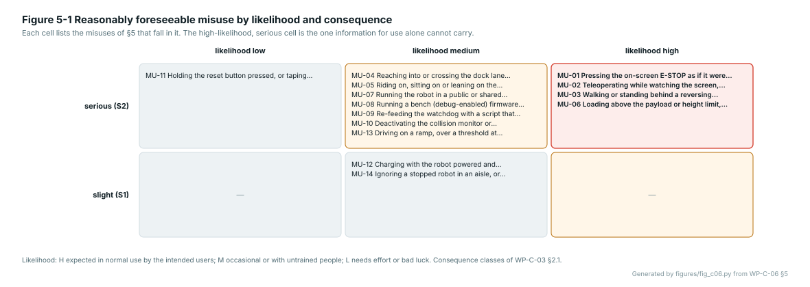

# WP-C-06 Human-robot interaction, collaborative operation and reasonably foreseeable misuse analysis

| Field | Value |
|---|---|
| Work product | WP-C-06 Human-robot interaction, collaborative operation and reasonably foreseeable misuse analysis |
| Standard reference | Machinery: 10218-2 §5; TS 15066 §5; 12100 §5.3; 3691-4 §4 (personnel detection); Other: ISO 13855 §5–§6 |
| Version | 0.1 (2026-10-20): interaction scenarios IS-01…IS-12, safety-distance derivation, collaborative-operation interface assumptions, misuse MU-01…MU-14, operator interface and modes; Figures 2-1, 3-1, 5-1. 0.0: skeleton |
| Status | Draft |
| PL / scope | PL d target (DQ-005); Gate A unit (CFG-001); mobile base only; the arms only as interface assumptions (§4) |
| Author | Assurance team (AI-assisted draft, I0) |
| Reviewer(s) | TBD (I1; someone who has watched people around the robot) |
| Approver | Safety manager |
| Baseline | BL-001 |

> [!WARNING]
> Draft. The scenarios and misuses are derived from the record (upstream's user safety page, the docking and
> teleoperation documentation, the gap assessment) and from ISO 3691-4 experience, not from observation of
> people around this robot. The safety-distance figures in §3 are a derivation with placeholders for the one
> number nobody has measured, the stopping distance; the standard clauses are to be checked against a licensed
> copy before any field is configured from them.

## 1. Purpose

Analyses how people interact with the robot in each task and zone, what collaborative operation (ISO 10218-2,
ISO/TS 15066) would require when the arms come, and the reasonably foreseeable misuse of WP-C-01, with the
approach speeds and distances of ISO 13855 as the quantitative basis for personnel detection.

Zones and people presence are taken from WP-C-02. Hazards are those of [WP-C-03](WP-C-03-risk-assessment.md)
§4; the safety functions are SF-01…SF-07 of WP-C-03 §7. The outputs of this analysis are: the interaction
scenarios WP-V-03 validates against, the detection-distance formula WP-H-02 §3.3 sizes the protective field with,
the misuse list WP-O-03 warns about, and the requirements HR-01…HR-10 (§7) that go to WP-C-04 and WP-S-02.

## 2. Interaction scenarios

One scenario per way a person and the moving robot can meet. "Closest" is the distance at which the scenario
becomes a contact if nothing stops the robot; "relative speed" is the closing speed between person and robot.

| ID | Who | Zone (WP-C-02) | Task (WP-C-02 §3) | What the person is doing | Closest | Relative speed | Hazard | Measure needed |
|---|---|---|---|---|---|---|---|---|
| IS-01 | briefed staff | Z2 | T-01 | crosses the aisle ahead of the robot, seen from the side, at walking pace | 0 m if the robot does not stop | 1.6 + 0.2 m/s | H-01 | SF-02 field sized per §3; SF-03 |
| IS-02 | briefed staff | Z2 | T-01 | steps out from behind a rack or a doorway into the path, unseen until 0.5 m **(TBC)** ahead | 0.5 m | 1.6 + 0.2 m/s | H-01 | SF-02 cannot stop in time at 0.20 m/s unless the stop is short (§3); the zone speed near blind corners is lower (DQ-017) |
| IS-03 | briefed staff | Z2 | T-01 | walks alongside or follows the robot, inside 0.5 m of its side | 0 m at the side | 0.2 m/s | H-01 (pinning against a rack if the robot turns) | SF-02 lateral margin; the side sectors are masked in the scan today (GAP-35) |
| IS-04 | anyone | Z3 | T-04 | stands or walks behind the robot while it reverses out of the dock | 0 m | 0.10 m/s (today), 0.05 m/s (crawl) | H-01 | rear bumper, crawl limit (DQ-018); lane marked and empty (WP-C-02 Z3) |
| IS-05 | anyone | Z3 | T-03 | reaches or steps into the dock lane during the final blind approach | 0 m | 0.05 m/s | H-01 | lane field set at crawl; the approach must not go blind (GAP-15) |
| IS-06 | operator | Z1, Z2 | T-06 | teleoperates while watching the screen; the robot is not where the map says | 0 m for a bystander | 0.2 m/s | H-01, H-10 | SF-01 in the operator's hand; a deadman on the teleop device; operator watches the robot (WP-O-03) |
| IS-07 | technician | Z4 | T-05 | connects the charger with the robot powered; a command arrives from the network | 0 m | 0.2 m/s | H-02, H-08 | charge interlock opens the safety chain (WP-H-02 §3.6); mains never paralleled with the battery |
| IS-08 | anyone | Z2, Z5 | T-01, T-02 | pushes, leans on, sits on or rides the robot; places a hand on the top plate | 0 m | 0 | H-06, H-03 | payload and stability limits (WP-H-08); information for use; SF-06 stall detector trips when the wheels are blocked |
| IS-09 | child, animal, a person lying or crouching | Z2, Z5 | T-01 | below the LiDAR plane (0.18 m) and below the scanner plane | 0 m | 1.6 + 0.2 m/s | H-01 | SF-02 detection down to **(TBC: 0.3 m)** per SR-02.03; Z5 excluded until validated |
| IS-10 | briefed staff | Z2 | T-01 | stands still in the path; the robot waits, then the person steps aside and the robot resumes without warning | 0.5 m | 0.2 m/s | H-05, H-02 | audible and visual warning before motion resumes (HR-07); SF-05 after a protective stop that removed power |
| IS-11 | operator or bystander | any | any | presses the on-screen E-STOP expecting the robot to stop; it does not | — | — | H-10, H-02 | SR-01.09 labelling; the physical SF-01 within reach; training |
| IS-12 | bystander | Z2 | T-01 | tries to stop the robot by holding it or standing in front with a hand out | 0 m | 0.2 m/s | H-01, H-03 | SF-02; SF-06 stall detector; the robot's maximum push force (3.5 N·m per wheel at 0.1 m radius, about 70 N) is below ISO/TS 15066 transient limits for the body but not for the hand **(TBC)** |


*Figure 2-1.* The scenarios of the table as scene cards, drawn to a common scale (1 m grid). The protective field is the 1.0 m starting value of WP-H-02 §3.3; where the person is inside it or below its plane, the card says so. Generated by [`figures/fig_c06.py`](figures/fig_c06.py) from the §2 table; CI fails if it is stale.

## 3. Approach speeds and safety distances

The minimum detection distance in the direction of travel is derived from ISO 13855 (minimum distance of a
safeguard from a hazard zone as a function of the approach speed) adapted to a moving hazard, as ISO 3691-4
applies it to driverless trucks. Clause references are to be checked against licensed copies; the form of the
derivation is standard, the numbers are not yet.

| Symbol | Meaning | Value | Source |
|---|---|---|---|
| K | approach speed of a person | 1.6 m/s (ISO 13855 walking-speed value) | 13855 §6 |
| v | robot speed in the zone | 0.20 m/s (navigation), 0.05 m/s (crawl) | WP-C-02 §2 |
| t_r | reaction time from a person entering the field to the start of power removal | 0.17 s | WP-H-02 §3.2 (scanner 0.07–0.10 s, speed monitor 0.02 s, relay and contactors 0.05 s) |
| t_b | time from power removal to standstill | **(TBC)**; 0.5 s and 1.5 s are drawn as bounds | WP-V-02 stopping test |
| d_b | distance travelled from power removal to standstill (coasting on the Gate A unit) | **(TBC)**; 0.1 m to 0.5 m drawn | WP-V-02 stopping test |
| Z | measurement tolerance of the scanner plus mounting and odometry tolerance | 0.10 m | scanner datasheet (TBC) |
| C | intrusion allowance for a horizontal field (ISO 13855 gives C from the field height H; for a plane ≤ 0.3 m above the floor the allowance for stepping over is the term to confirm) | **(TBC)**; drawn as 0 and 0.85 m bounds | 13855 §6.2 |

The person walks toward the robot for the whole stopping time while the robot still moves toward the person:

```
L  =  v · t_r  +  d_b  +  K · (t_r + t_b)  +  Z  +  C
```

For the navigation speed with the drawn bounds: at t_b = 0.5 s and d_b = 0.1 m, L = 0.034 + 0.1 + 1.07 + 0.1 + C
= **1.3 m + C**; at t_b = 1.5 s and d_b = 0.5 m, L = 0.034 + 0.5 + 2.67 + 0.1 + C = **3.3 m + C**. The term that
dominates is the person's walk during the robot's stopping time, not the robot's own travel: a long coasting stop
costs field length at 1.6 m per second of coasting. This is why the stopping-distance measurement (WP-C-01 OI-2)
and a brake on the drive (2.0 hub motors) matter more to SF-02 than the robot's speed does.


*Figure 3-1.* The §3 formula drawn against the one unmeasured input. The 1.0 m starting field of WP-H-02 §3.3 is enough only if the robot stops within about 0.4 s of power removal and C is small; a coasting stop of a second or more needs a 2 to 3 m field, which the scanner's range allows but the aisle may not. Generated by [`figures/fig_c06.py`](figures/fig_c06.py) from the §3 parameter table; CI fails if it is stale.

Consequences for the design:

- SF-02's field length is set after WP-V-02 measures d_b and t_b on the worst floor in use, loaded; until then the
  1.0 m start value is a placeholder and no claim is made (WP-H-02 §3.3).
- The crawl speed does not shorten the field much (the person's walk dominates); it shortens the robot's own
  travel and the energy at contact, which is why it is the dock-lane and reverse limit.
- Blind corners (IS-02) cannot be covered by field length; they need a zone speed low enough that a 0.5 m
  warning suffices, or mirrors, or a one-way rule for people, which is a site measure (WP-O-03).
- Lateral margin (IS-03): the field's width exceeds the footprint by Z plus the lateral sway of the robot (TBC)
  on each side; the side scan masks of the navigation filter do not apply to the safety scanner.

## 4. Collaborative operation (arms, later)

The base claims no collaborative operation: nobody is meant to touch it while it moves, and it carries no
power-and-force-limited function. When the OpenArm 2.0 arms and the lift arrive (second item, DQ-004), the
following are the interface assumptions this item hands over, to be confirmed or replaced in that item's analysis:

| ID | Assumption for the mobile manipulator | Why it comes from the base |
|---|---|---|
| CA-01 | The base does not move while an arm is outside its stowed pose; a base motion command is refused by the safety chain while the arm "not stowed" signal is present | the arms' reach (upstream: "larger than it looks") adds to the footprint; SF-02's field is sized for the base |
| CA-02 | An arm motion is a collaborative operation only if the arm's own power-and-force limiting meets ISO/TS 15066 body-region limits, verified by measurement; otherwise it needs speed-and-separation monitoring with a field that covers the arm's reach | the base's scanner field does not cover a raised arm |
| CA-03 | The emergency stop (SF-01) removes power from the arms and the lift as well as from traction, and the lift holds its load on power loss (upstream `ESTOP-SCOPE`, `LIFT` release gates) | one stop device for the whole machine |
| CA-04 | The lift moves only in the stowed or carry pose with the base stopped (upstream `LIFT` motion rules) | stability (H-06) |
| CA-05 | The mass and centre-of-gravity limits of WP-H-08 include the arms, lift and payload in every pose | tipping margins are a base property |

## 5. Reasonably foreseeable misuse

Likelihood: **H** (expected in normal use of this robot by its intended users), **M** (will happen occasionally
or with untrained people), **L** (needs effort or bad luck). Consequence uses the WP-C-03 severity classes.

| ID | Misuse | Likelihood | Consequence | Hazard | Why it is foreseeable | Measure (design / safeguard / information) |
|---|---|---|---|---|---|---|
| MU-01 | Pressing the on-screen E-STOP as if it were an emergency stop | H | S2 | H-10, H-02 | it is red and labelled E-STOP; upstream's own page warns of it | design: label and style change (SR-01.09); safeguard: SF-01 physical; information: WP-O-03 |
| MU-02 | Teleoperating while watching the screen, not the robot | H | S2 | H-01, H-10 | the UI invites it; the map can show a different room | information and training; design: deadman on the teleop device (HR-04); safeguard: SF-02 |
| MU-03 | Walking or standing behind a reversing robot | H | S2 | H-01 | nobody expects a robot to reverse; the rear is unseen | design: crawl reverse and rear bumper (DQ-018); information: markings |
| MU-04 | Reaching into or crossing the dock lane during docking | M | S2 | H-01 | the dock is where people put things | safeguard: lane field at crawl; information: marked lane |
| MU-05 | Riding on, sitting on or leaning on the robot | M | S2 | H-06, H-03 | it is at seat height with a flat top plate | information: markings; design: payload limit, stall detector |
| MU-06 | Loading above the payload or height limit, or an unrestrained load | H | S2 | H-06 | there is no limit stated today | design: limit and restraint points (WP-H-08); information |
| MU-07 | Running the robot in a public or shared area before SF-02 exists | M | S2 | H-01 | demonstrations are what the robot is for | information: WP-C-02 exclusions; organisational: WP-V-07 hold point |
| MU-08 | Running a bench (debug-enabled) firmware image on the ground | M | S2 | H-04, H-02 | the per-boot calibration needs it | design: image reports `dbg=1`; arming key switch (SR-07.03); procedure |
| MU-09 | Re-feeding the watchdog with a script that republishes the last command | M | S2 | H-02 | upstream's calibration tools already do it | design: sequenced commands (SR-04.03); information |
| MU-10 | Deactivating the collision monitor or changing a safety parameter from the network because a manoeuvre keeps aborting | M | S2 | H-12, H-01 | the docking sequencer does exactly this today | design: safety parameters locked (SR-00.05); no safety function in the ROS 2 stack |
| MU-11 | Holding the reset button pressed, or taping it, to stop nuisance trips | L | S2 | H-05 | common with safety relays | design: monitored reset (SR-01.06) refuses a held reset |
| MU-12 | Charging with the robot powered and connected to the network | M | S1 | H-08, H-02 | convenient | design: charge interlock opens the chain (WP-H-02 §3.6) |
| MU-13 | Driving on a ramp, over a threshold at speed, or near an edge to save a detour | M | S2 | H-06 | SMEs have ramps and docks | information: exclusions; design: geofence (WP-C-02 OI-3) |
| MU-14 | Ignoring a stopped robot in an aisle, or pushing it aside by hand | M | S1 | H-05, H-03 | a silent stop looks like idling | design: stop indication (SR-00.04); SF-05 reset; information |



*Figure 5-1.* The misuses of the table placed by likelihood and consequence. The five in the high-likelihood, serious cell are the ones the information for use alone cannot carry: each has a design or safeguard measure in the table. Generated by [`figures/fig_c06.py`](figures/fig_c06.py) from the §5 table; CI fails if it is stale.

## 6. Operator interface and modes

| Topic | Requirement on the interface | Today |
|---|---|---|
| Mode selection | The operator selects teleoperation, autonomous or docking deliberately; the robot does not change mode because another publisher appeared; a mode change is indicated at the robot (stack light) and on the UI | no arbitration: whoever publishes last wins (GAP-36) |
| Mode indication | Stack light: green running, amber slowed or waiting on a person, red stopped or fault, flashing red reset required; the same four states on the UI | an LED on the Teensy |
| The physical stop | A pendant E-stop in the operator's hand during teleoperation and testing; fixed E-stops reachable from both long sides; the UI shows the chain state and cannot clear it | none |
| The on-screen stop | Labelled "stop request", not red-mushroom styled; its effect (zero command, cancel goal) stated next to it | labelled E-STOP, red (MU-01) |
| Teleoperation | A deadman: motion only while a control is held; release stops within 200 ms through the firmware watchdog; speed capped at the zone limit, lower within 2 m of a person (DQ-017) | keyboard teleop floods `/cmd_vel`; no deadman |
| Waiting on a person | After a protective slow-down or stop, motion resumes with an audible and visual warning of **(TBC: 2 s)** | resumes silently |
| Reset | At the robot, deliberate, impossible while a stop demand is present; the UI shows "reset required" | none |
| Docking | The lane state (robot docking, keep clear) is shown at the dock and on the UI | none |

## 7. Requirements derived here (to WP-C-04, WP-S-02 and WP-O-03)

| ID | Requirement | Goes to |
|---|---|---|
| HR-01 | SF-02's protective field in the direction of travel shall be at least L of §3 with the measured d_b, t_b and the confirmed C, per zone speed | WP-S-02 SR-02.02 |
| HR-02 | SF-02 shall detect a person down to **(TBC: 0.3 m)** above the floor (IS-09) | SR-02.03 |
| HR-03 | Reverse motion shall be limited to the crawl speed and covered by rear detection (IS-04) | SR-02.04, DQ-018 |
| HR-04 | Teleoperation shall require a held control (deadman) and shall cap speed near a person (IS-06, MU-02) | WP-S-02 new SR-08.x; WP-C-04 |
| HR-05 | The on-screen stop shall not be presented as an emergency stop (MU-01) | SR-01.09; WP-O-03 |
| HR-06 | Motion after a protective slow-down, stop or wait shall be preceded by an audible and visual warning (IS-10) | WP-C-04 new SF-08 "warning before motion"; WP-H-02 (stack light, sounder) |
| HR-07 | The robot's state (running, slowed, stopped, reset required) shall be visible from every side (MU-14) | SR-00.04 |
| HR-08 | A payload limit, a height limit and restraint points shall be marked on the top plate (MU-05, MU-06) | WP-H-08; WP-O-03 §4 |
| HR-09 | Blind corners and one-way rules for people in Z2 shall be site measures recorded in the site survey (IS-02) | WP-O-03; WP-C-02 OI-5 |
| HR-10 | The base shall refuse motion while an arm is not stowed (CA-01), as an interface requirement for the second item | WP-S-02 (second item) |

## 8. Open items

| ID | Item | Owner | Due |
|---|---|---|---|
| OI-1 | Measure d_b and t_b (WP-V-02) and confirm C and Z against licensed ISO 13855 and the scanner datasheet; then set L per zone | Safety manager | G2 |
| OI-2 | Lead decisions DQ-017 (speed near a person) and DQ-018 (reverse) | Project lead | G1 |
| OI-3 | Observe people around the Gate A unit in Z1 for one session and correct the likelihood ratings of §5 | Reviewer | G1 |
| OI-4 | Confirm the push-force figure of IS-12 by measurement against a force gauge; compare with ISO/TS 15066 Annex A limits for the hand | Hardware lead | G2 |
| OI-5 | Specify the teleop device with a deadman (HR-04) and the sounder and stack light (HR-06, HR-07) in WP-H-02 | Hardware lead | G2 |
