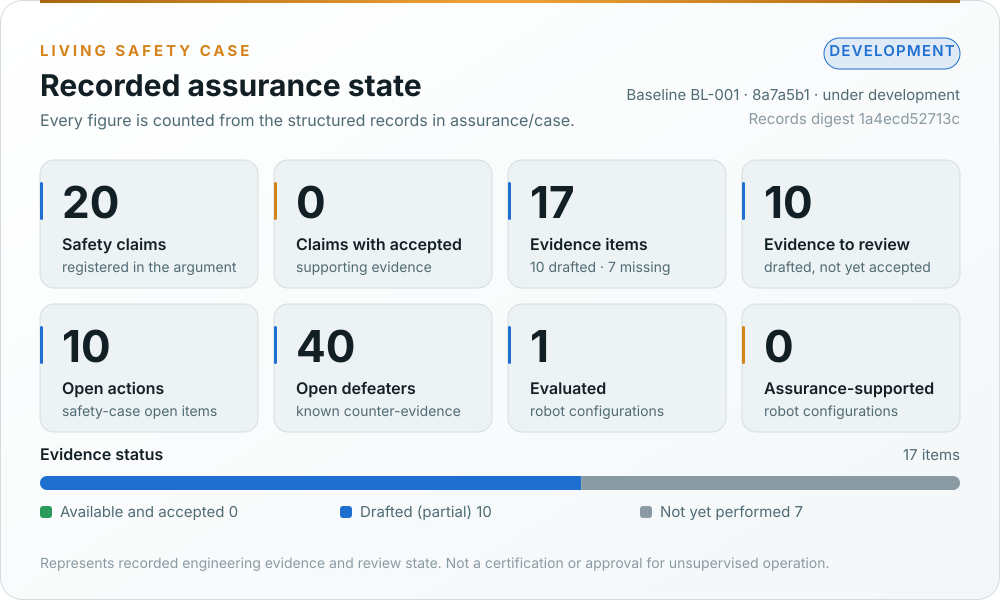
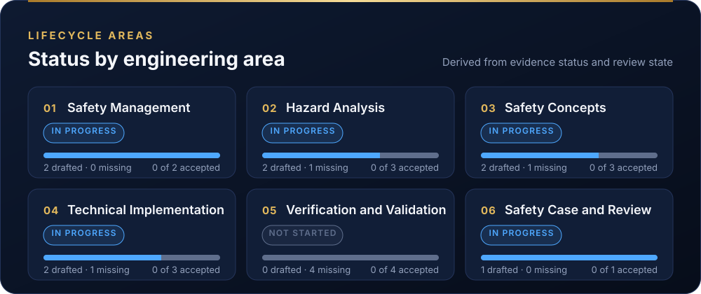

# OpenAMRobot assurance repository

This tree holds the engineering assurance work products for the OpenAMRobot fork: machinery risk assessment
(ISO 12100), AMR and robot safety requirements (ISO 3691-4, ISO 10218, ISO/TS 15066), safety-related control
(ISO 13849-1), cybersecurity (IEC 62443) and the regulatory file for Regulation (EU) 2023/1230. Safety-case
structure follows UL 4600 principles. The layout, identifiers and lifecycle are LionDriver's, so the Living Safety
Case tooling can be shared.

> [!WARNING]
> Everything here is a **draft prepared for engineering review**. None of it has passed verification review,
> confirmation review or a functional-safety assessment. A document existing here does not mean the activity behind
> it is complete. Read the `Status` field of each work product.

## Living Safety Case

  

  

<b>Recorded values as text</b>

<!-- BEGIN GENERATED: assurance-summary (assurance/case/tools/generate_dashboard.py) -->

| Indicator | Recorded value |
|---|---|
| Assurance state | Development |
| Engineering baseline | `BL-001` at `8a7a5b1` (under development) |
| Registered safety claims | 18 |
| Claims with accepted supporting evidence | 0 |
| Registered evidence items | 15 (0 available, 8 drafted, 7 not yet performed) |
| Evidence requiring review | 8 |
| Open assurance actions | 11 |
| Open defeaters (known counter-evidence) | 40 |
| Evaluated configurations | 1 |
| Assurance-supported configurations | 0 |
| Records digest | `046324807e6a` |

| Lifecycle area | Status | Evidence (drafted / missing / accepted) |
|---|---|---|
| Safety Management | In Progress | 2 (2 / 0 / 0) |
| Hazard Analysis | In Progress | 3 (2 / 1 / 0) |
| Safety Concepts | In Progress | 3 (2 / 1 / 0) |
| Technical Implementation | In Progress | 2 (1 / 1 / 0) |
| Verification and Validation | Not Started | 4 (0 / 4 / 0) |
| Safety Case and Review | In Progress | 1 (1 / 0 / 0) |

<!-- END GENERATED: assurance-summary -->

**What the dashboard guarantees:** a claim counts as accepted only when a recorded review accepts it, every piece of evidence it cites is available and accepted, and no defeater against it is open. The validator (`case/tools/validate.py`) refuses anything else. A passing CI run or the existence of a document never accepts a claim.

## Layout

| Folder | Content | Primary standard clauses |
|---|---|---|
| `00-assessment/` | Baseline gap assessment of the inherited repositories | n/a |
| `01-management/` | Assurance strategy, safety plan, roles, the decision register | ISO 13849-1 §4, IEC 61508-1 §6, Machinery Reg. Annex VII |
| `02-concept/` | Machine limits, risk assessment, safety functions and their required PL, cybersecurity goals | ISO 12100 §5, ISO 3691-4 §4–5, ISO 13849-1 §5 |
| `03-system/` | Safety-related control architecture, categories, diagnostic coverage, interfaces | ISO 13849-1 §6, ISO 3691-4 §5 |
| `04-hardware/` | Safety chain hardware, MTTFd, CCF, component qualification | ISO 13849-1 Annex C–F, ISO 13849-2 |
| `05-software/` | Safety-related software (firmware, Nav2 chain), SRESW/SRASW | ISO 13849-1 §7, IEC 61508-3 |
| `06-validation/` | Validation plan and records: stopping distance, protective fields, E-stop, fault injection | ISO 13849-2 §5, ISO 3691-4 Annex A |
| `07-supporting/` | Configuration, change and problem management, tool and component qualification | IEC 61508-1 §7, ISO 13849-1 §10 |
| `08-analyses/` | FMEA, FTA, STPA, common-cause analysis | ISO 13849-1 Annex F, IEC 60812 |
| `09-production-operation/` | Information for use, installation, operation, field monitoring | ISO 12100 §6.4, ISO 3691-4 §7 |
| `10-safety-case/` | Safety case, technical file, assessment and release records | Machinery Reg. Annex VII, UL 4600 |
| `case/` | Living Safety Case records (claims, evidence, defeaters, actions, configurations, baselines, reviews), validator and dashboard generator, ported from LionDriver | UL 4600 |
| `trace/` | Machine-readable hazards, requirements and trace data | ISO 13849-1 §10 |

## Conventions

Identifiers and the document-control header follow LionDriver's assurance README. Differences:

| Prefix | Meaning | Example |
|---|---|---|
| `H-<nn>` | Hazard from the ISO 12100 risk assessment | `H-03` |
| `SF-<nn>` | Safety function, with its required Performance Level `PLr` | `SF-01` (emergency stop, PLr d) |
| `SRP-<nn>` | Safety-related part of the control system that implements a safety function | `SRP-02` |
| `GAP-<nn>` | Finding of the baseline gap assessment; never reused | `GAP-17` |

## Reference configuration

The assessed configuration is upstream's **Gate A unit**, the robot that has been wired, flashed and driven: the
v0.0.1 differential-drive base on a Raspberry Pi 5 and a Teensy 4.0. OpenAMRobot 2.0 (Jetson, STM32H723 base
controller, hub motors with brakes, a Pilz safety relay chain, dual arms and a lift) is decided in upstream's plan
set but not yet in any public repository; its decisions are tracked, not assessed.
