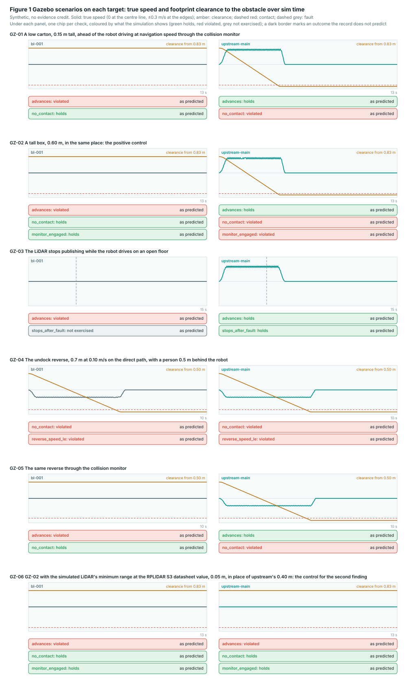

# Gazebo scenario results

> Generated by [`../evaluate.py`](../evaluate.py) from the traces in [`traces/`](traces/); do not edit by hand.
> Simulation: development evidence only, no evidence credit (see [`../README.md`](../README.md)).

**28 of 28 checks show what the record predicts.** Nav2 `58e4019`, laser_filters `959c848`, base image `sha256:243dec3ba8c7`.

| Target | Software | Scan body filter |
|---|---|---|
| `bl-001` | `8a7a5b1` (BL-001) | laser_filters scan_to_scan_filter_chain with scan_body_filter.yaml |
| `upstream-main` | `7494771` (not a baseline) | openamrobot_perception/scan_body_filter with scan_body_filter_sim.yaml |

| Scenario | Check | `bl-001` predicted / observed | `upstream-main` predicted / observed |
|---|---|---|---|
| GZ-01 | advances | violated / violated | holds / holds |
|  | no_contact | holds / holds | violated / violated |
| GZ-02 | advances | violated / violated | holds / holds |
|  | no_contact | holds / holds | violated / violated |
|  | monitor_engaged | holds / holds | violated / violated |
| GZ-03 | advances | violated / violated | holds / holds |
|  | stops_after_fault | not exercised / not exercised | holds / holds |
| GZ-04 | no_contact | violated / violated | violated / violated |
|  | reverse_speed_le | violated / violated | violated / violated |
| GZ-05 | advances | violated / violated | holds / holds |
|  | no_contact | holds / holds | violated / violated |
| GZ-06 | advances | violated / violated | violated / violated |
|  | no_contact | holds / holds | holds / holds |
|  | monitor_engaged | holds / holds | holds / holds |

Monitor actions are nav2_msgs/CollisionMonitorState codes: 0 nothing, 1 stop, 2 slow down, 3 approach, 4 limit.

## Measured

| Scenario | Target | Measured |
|---|---|---|
| GZ-01 | `bl-001` | travel 0.0 m; min clearance 0.835 m; max 0.0 m/s forward, 0.0 m/s reverse; monitor actions 0, 3 |
|  | `upstream-main` | travel 0.86 m; min clearance 0.0 m, contact at 4.25 s; max 0.209 m/s forward, 0.0 m/s reverse; monitor actions 0 |
| GZ-02 | `bl-001` | travel 0.0 m; min clearance 0.835 m; max 0.0 m/s forward, 0.0 m/s reverse; monitor actions 0, 3 |
|  | `upstream-main` | travel 0.86 m; min clearance 0.0 m, contact at 4.251 s; max 0.209 m/s forward, 0.0 m/s reverse; monitor actions 0 |
| GZ-03 | `bl-001` | travel 0.0 m; 0.0 m/s at the fault, 0.0 m after it, still at 4.0 s; max 0.0 m/s forward, 0.0 m/s reverse; monitor actions 0, 1, 3 |
|  | `upstream-main` | travel 0.978 m; 0.2 m/s at the fault, 0.223 m after it, still at 5.5 s; max 0.209 m/s forward, 0.0 m/s reverse; monitor actions 0, 1 |
| GZ-04 | `bl-001` | travel 0.501 m; min clearance 0.0 m, contact at 4.85 s; max 0.0 m/s forward, 0.104 m/s reverse; monitor actions 0 |
|  | `upstream-main` | travel 0.501 m; min clearance 0.0 m, contact at 4.85 s; max 0.0 m/s forward, 0.104 m/s reverse; monitor actions 0 |
| GZ-05 | `bl-001` | travel 0.0 m; min clearance 0.5 m; max 0.0 m/s forward, 0.0 m/s reverse; monitor actions 0, 3 |
|  | `upstream-main` | travel 0.501 m; min clearance 0.0 m, contact at 4.85 s; max 0.0 m/s forward, 0.104 m/s reverse; monitor actions 0 |
| GZ-06 | `bl-001` | travel 0.0 m; min clearance 0.835 m; max 0.0 m/s forward, 0.0 m/s reverse; monitor actions 0, 3 |
|  | `upstream-main` | travel 0.0 m; min clearance 0.835 m; max 0.0 m/s forward, 0.0 m/s reverse; monitor actions 0, 3 |

## Why each prediction

- **GZ-01** A low carton, 0.15 m tall, ahead of the robot driving at navigation speed through the collision monitor. advances: `bl-001` GAP-40: the monitor sees the robot's own body and holds it still; `upstream-main` the per-sector filter removes the body returns and the robot drives. no_contact: `bl-001` only because the robot never moves; `upstream-main` GAP-14: an object below the 0.222 m scan plane is invisible to every software layer.
- **GZ-02** A tall box, 0.60 m, in the same place: the positive control. advances: `bl-001` GAP-40, as in GZ-01; `upstream-main` the robot drives towards the box. no_contact: `bl-001` only because the robot never moves; `upstream-main` GAP-40: the box leaves the scan 0.315 m ahead of the footprint (LiDAR minimum range 0.40 m, mounted 0.085 m behind the front), before the 0.16 m approach look-ahead reaches it. monitor_engaged: `bl-001` on the robot's own body (the baseline finding); `upstream-main` the monitor never has the box inside its look-ahead.
- **GZ-03** The LiDAR stops publishing while the robot drives on an open floor. advances: `bl-001` GAP-40, as in GZ-01; `upstream-main` the robot drives until the fault. stops_after_fault: `bl-001` the robot is already standing when the scan stops; `upstream-main` GAP-16: with source_timeout 1.0 the monitor runs on the last scan for up to a second, then stops on an invalid source: 0.20 m at 0.20 m/s, 0.02 m for one scan period and 0.04 m braking at 0.5 m/s2 make 0.26 m.
- **GZ-04** The undock reverse, 0.7 m at 0.10 m/s on the direct path, with a person 0.5 m behind the robot. no_contact: GAP-35 and GAP-36: the sequencer reverses blind on /cmd_vel, past every software layer. reverse_speed_le: SR-02.04 and DQ-018 A ask 0.05 m/s; the software reverses at 0.10 m/s (the fork change is not made yet).
- **GZ-05** The same reverse through the collision monitor. advances: `bl-001` GAP-40, as in GZ-01; `upstream-main` the robot reverses. no_contact: `bl-001` only because the robot never moves; `upstream-main` GAP-35: the per-sector filter removes the rear 66 degrees at every range, so the monitor cannot see behind the robot.
- **GZ-06** GZ-02 with the simulated LiDAR's minimum range at the RPLIDAR S3 datasheet value, 0.05 m, in place of upstream's 0.40 m: the control for the second finding. advances: `bl-001` GAP-40, as in GZ-01; `upstream-main` GAP-40: at 0.05 m the scan shows the robot's own posts at 0.23 to 0.27 m, at -38 to -36 and +32 to +38 degrees, just outside the sim mask of -35 to +31 degrees; the monitor holds the robot still. no_contact: only because the robot never moves. monitor_engaged: on the robot's own body.
