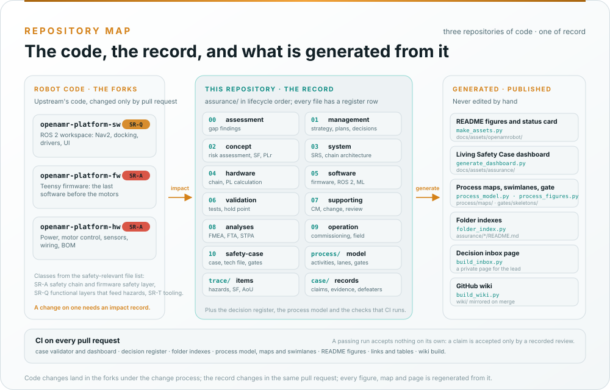

# How the repository is organized

This repository holds the record, not the robot's code. The code lives in the forked platform repositories; the
record is what the fork adds around it.

*Generated by [`make_assets.py`](../docs/assets/openamrobot/make_assets.py). Left: the code, classed by the
safety-relevant file list. Middle: this repository. Right: what is generated from it and never edited by hand.*

## The forked platform repositories

| Repository | What it is |
|---|---|
| `openamr-platform-sw` | The ROS 2 Jazzy workspace: Nav2 configuration, docking, drivers, perception, bring-up, the operator UI |
| `openamr-platform-fw` | The Teensy 4.0 firmware, an overlay on the linorobot2 base: command handling, PID, encoders, the watchdog |
| `openamr-platform-hw` | The hardware record: power, motor control, sensors, wiring, mechanical, BOM |

Changed by pull request in those repositories under the fork's change process; the assessed baseline is named in
the [gap assessment](../assurance/00-assessment/gap-assessment.md) header. Upstream's register of approved values
(`openAMRobot/.github/decisions.yaml`) is quoted, never restated.

## This repository

| Path | What it is |
|---|---|
| [`assurance/`](../assurance/README.md) | Every work product, analysis, decision and review |
| [`assurance/process/`](../assurance/process/README.md) | The integrated process model: activities, lanes, interfaces and gates as data; generated process maps |
| [`assurance/01-management/decisions/`](../assurance/01-management/decisions/README.md) | The decision register and the inbox page builder |
| [`assurance/tools/`](../assurance/tools/) | The folder index generator, the link and table checkers |
| [`docs/`](../docs/README.md) | The architecture overview and the generated README figures |
| [`tools/wiki/`](../tools/wiki/) | The wiki build tool and infographics |
| [`wiki/`](../wiki/README.md) | These pages |
| [`.github/workflows/`](../.github/workflows) | The assurance checks and the wiki sync |

Changed by pull request to `main` and checked by the workflows below.

## The assurance tree, folder by folder

Folders are numbered in lifecycle order. Each work product is named `WP`, a letter for its area, and a number; the
[glossary](Glossary.md) decodes the letters. The authoritative table, with the standard clauses each folder answers
to, is in [`assurance/README.md`](../assurance/README.md#layout), and each folder's README is generated from the
register.

| Folder | Prefix | What it holds |
|---|---|---|
| `00-assessment/` | | Gap assessment of the inherited repositories, GAP-01…GAP-40 |
| `01-management/` | `WP-M` | Assurance strategy, safety plan, confirmation measures, regulatory strategy, cybersecurity and ML plans, upstream management, impact analysis, the decision register |
| `02-concept/` | `WP-C` | Machine definition, operating environment, risk assessment, safety functions and required PL, risk reduction concept, interaction and misuse, cybersecurity and ML concepts, insufficiency analysis |
| `03-system/` | `WP-S` | Safety requirements specification, SRP/CS architecture, stopping budget, safety-chain I/O, cybersecurity architecture, system verification |
| `04-hardware/` | `WP-H` | Safety-chain hardware, electrical safety, failure analysis, PL calculation, component qualification, stability analysis |
| `05-software/` | `WP-W` | Firmware and ROS 2 chain: requirements, architecture, safety analysis, units, verification, safety parameters, ML engineering |
| `06-validation/` | `WP-V` | Safety validation, stopping and detection tests, E-stop validation, fault injection, cybersecurity validation, the test operations hold point, field trials |
| `07-supporting/` | `WP-P` | Configuration, change, problem resolution, documentation, review, traceability, tool and component qualification, release |
| `08-analyses/` | `WP-A` | FMEA, FTA, common cause failure, STPA, independence of the safety chain |
| `09-production-operation/` | `WP-O` | Assembly and commissioning, operation, information for use, field monitoring, incident response |
| `10-safety-case/` | `WP-K` | The safety case, the technical documentation index, the cybersecurity case, assessment reports, release record; gate and confirmation records |
| `process/`, `trace/`, `case/` | `WP-P-11`, `WP-T-01` | The process model with its maps and swimlane figures, the trace items (hazards, safety functions, assumptions of use) and the Living Safety Case records with their validator and dashboard |

## What checks a change

Every workflow lives in [`.github/workflows/`](../.github/workflows).

| Workflow | Runs when | What it checks |
|---|---|---|
| [assurance](../.github/workflows/assurance.yaml) | Every pull request and push to `main` | The Living Safety Case records, their validator tests and the dashboard; the decision register's lifecycle rules and its figure; the folder indexes against the register; the process model with its maps, gate skeletons and swimlane figures; the README figures against their generator; relative links; Markdown tables |
| [wiki](../.github/workflows/wiki.yaml) | Every pull request, and every push to `main` | Builds these pages and checks that every link target still exists; on a push, syncs them and the rendered infographics to the GitHub wiki |

A passing workflow accepts nothing on its own. It can be evidence that a reviewer accepts; see
[contributing](../CONTRIBUTING.md).

## What is generated

| Generated | From | By |
|---|---|---|
| Folder READMEs under `assurance/` | WP-M-00 §3 | `assurance/tools/folder_index.py` |
| Process maps and gate skeletons | `assurance/process/model/`, WP-M-00, WP-M-02, WP-M-06 | `assurance/process/tools/process_model.py` |
| Process swimlanes, lifecycle grid and interface figures | The same model | `assurance/process/tools/process_figures.py` |
| Living Safety Case dashboard, status, badge and README blocks | `assurance/case/` records | `assurance/case/tools/generate_dashboard.py` |
| README and wiki figures (hero, standards, architecture, roadmap, lifecycle, status card, standards map, repository map) | The data in the generator and the records | `docs/assets/openamrobot/make_assets.py` |
| Decision lifecycle figure | The decisions README | `assurance/01-management/decisions/fig_lifecycle.py` |
| The decision inbox page | `register.yaml` | `assurance/01-management/decisions/build_inbox.py` |
| Wiki infographics | `register.yaml`, WP-M-00, the safety-relevant file list, the workflows | `tools/wiki/infographics.py` at sync |

None of them is edited by hand; CI fails when one is stale.
