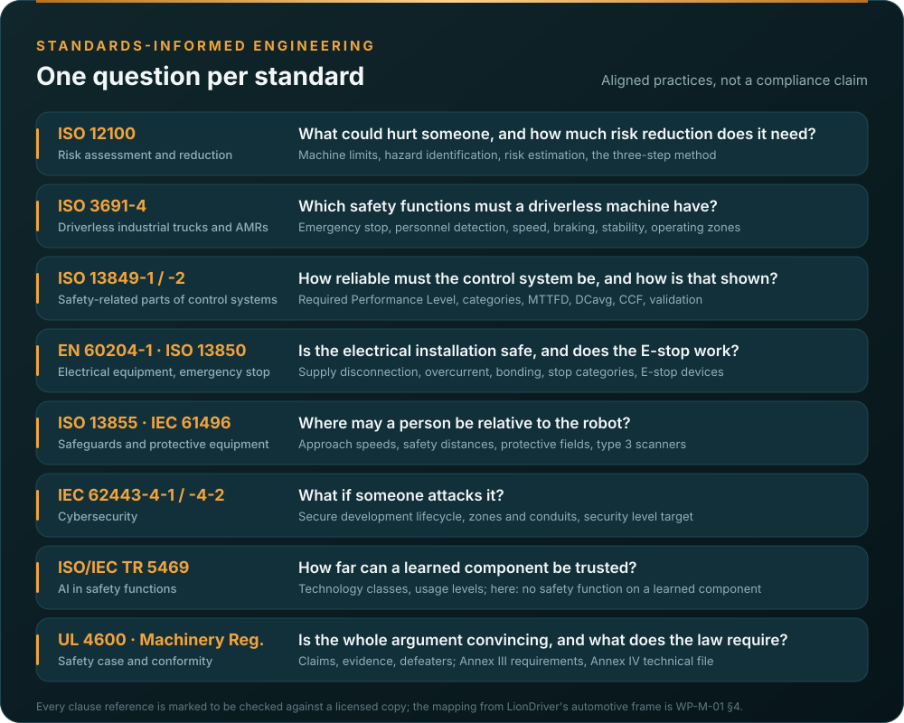

# How we use each standard

OpenAMRobot is a machine, not a road vehicle. The standards are the machinery set, applied with one method: one
hazard log, one requirements database, generated figures, a safety case with its
defeaters published. This page says, for each standard, what the fork takes from it, what it does not claim, and
where it lands in the record. The authoritative version is
[WP-M-01 §4 and §5](../assurance/01-management/WP-M-01-assurance-strategy.md#4-the-standards-and-how-each-one-is-used).
**No compliance is claimed** with any of them, because no assessment has been performed and the drafting
environment has no licensed copy; every clause reference is marked to be checked.

*Which gate needs the work products that cite each standard is the [standards map](Standards-at-a-glance.md#where-each-standard-lands-in-the-lifecycle).*

## ISO 12100:2010, risk assessment and risk reduction

- **What we take:** the whole method. Machine limits (use, space, time), hazard identification per life phase,
  risk estimation and evaluation, then the three-step method in order: inherently safe design, safeguarding and
  complementary protective measures, information for use. The documentation of §7 becomes the heart of the
  technical file.
- **How:** [WP-C-01](../assurance/02-concept/WP-C-01-item-definition.md) defines the machine and its
  limits, [WP-C-03](../assurance/02-concept/WP-C-03-risk-assessment.md) is the one hazard log of the project, and
  [WP-C-05](../assurance/02-concept/WP-C-05-risk-reduction-concept.md) allocates every hazard to the three steps.
- **Position taken:** a limitation that is only documented is not a control for a hazard that can kill; the gap
  assessment's worst findings (nothing seen below the LiDAR plane, docking with protection switched off) are closed by
  design or safeguarding, not by a warning.

## ISO 3691-4:2023, driverless industrial trucks and their systems

- **What we take:** the C-type requirements for an AMR: the list of significant hazards (Annex A) as the checklist
  for the risk assessment, and the safety functions a driverless machine must have: emergency stop, personnel
  detection with a protective stop, speed control, braking, stability, operating zones with their rules, and the
  verification of each.
- **How:** [WP-C-04](../assurance/02-concept/WP-C-04-safety-functions-and-plr.md) specifies SF-01 emergency stop,
  SF-02 protective stop, SF-03 safely limited speed, SF-04 stop on loss of control and the rest, each with the
  required Performance Level; [WP-C-02](../assurance/02-concept/WP-C-02-operating-environment-and-tasks.md) defines
  the zones; the validation work products test them.
- **Position taken:** where people share the space, ISO 3691-4 expects PL d for the stop functions. That is the
  planning assumption (decision DQ-005) and it drives the hardware the fork must add.

## ISO 10218-1/-2:2025 and ISO/TS 15066:2016, industrial robots and collaborative operation

- **What we take:** the requirements for the arms and the lift when they come, and the power and force limits of
  collaborative operation as interface assumptions the base case states now.
- **How:** [WP-C-06](../assurance/02-concept/WP-C-06-human-robot-interaction-and-misuse.md) carries the
  collaborative-operation section; the first machine definition is the base only (decision DQ-004).

## ISO 13849-1:2023 and ISO 13849-2:2012, safety-related parts of control systems

- **What we take:** the Performance Level as the measure of a safety function, the risk graph for the required PL,
  the designated architectures (categories B to 4), MTTFD, DCavg and CCF, the software requirements of §7, the
  verification of §8, validation with the fault lists of 13849-2, and the documentation and information-for-use
  requirements.
- **How:** [WP-S-02](../assurance/03-system/WP-S-02-safety-requirements.md) (SRS),
  [WP-S-03](../assurance/03-system/WP-S-03-technical-safety-concept.md) (architecture and categories),
  [WP-H-04](../assurance/04-hardware/WP-H-04-reliability-data-and-pl-calculation.md) (the PL calculation, with a
  SISTEMA project as the record), [WP-H-07](../assurance/04-hardware/WP-H-07-safety-component-qualification.md)
  (certified and well-tried components), [WP-V-01](../assurance/06-validation/WP-V-01-safety-validation.md) and
  [WP-V-05](../assurance/06-validation/WP-V-05-fault-injection.md) (validation and fault lists).
- **Position taken:** the safety functions are allocated to a **hardwired safety chain** (E-stop, safety relay,
  contactors, brakes, safety scanner outputs). The Teensy firmware and the ROS 2 stack are functional layers that
  are hardened but carry no PL claim in the first safety case (decision DQ-014). That keeps the PL d argument inside
  components with certificates and known reliability data, and matches upstream's own principle that watchdogs and
  telemetry are never safety evidence.

## IEC 62061:2021 and IEC 61508:2010, where ISO 13849 runs out

- **What we take:** management of functional safety (61508-1 §6), the functional safety assessment and its
  independence (61508-1 §8), software requirements beyond §7 of 13849-1 (61508-3) if the firmware is ever promoted
  into the safety chain, and the tool classification T1 to T3.
- **How:** [WP-M-02](../assurance/01-management/WP-M-02-safety-plan.md), [WP-M-06](../assurance/01-management/WP-M-06-confirmation-measures-plan.md),
  [WP-P-07](../assurance/07-supporting/WP-P-07-tool-classification-qualification.md), the software work products.
- **Position taken:** no SIL claim is made. The target measure is the Performance Level; IEC 61508 supplies the
  management and assessment structure the machinery standards leave thin.

## EN 60204-1:2018 and ISO 13850:2015, electrical equipment and the emergency stop

- **What we take:** the supply disconnecting device, overcurrent protection, protection against electric shock,
  protective bonding, control circuits and stop categories 0 and 1, the verification tests of §18; the emergency
  stop function and its devices.
- **How:** [WP-H-05](../assurance/04-hardware/WP-H-05-electrical-safety.md),
  [WP-H-02](../assurance/04-hardware/WP-H-02-electrical-and-safety-chain-design.md),
  [WP-V-04](../assurance/06-validation/WP-V-04-emergency-stop-and-safety-chain-validation.md).
- **Position taken:** the first engineering act of the fork is a fuse, a disconnect and a dual-channel E-stop
  through a safety relay on any unit it tests with, as bench equipment before it is a product design
  ([WP-V-07](../assurance/06-validation/WP-V-07-test-operations.md), decision DQ-011).

## ISO 13855:2024 and IEC 61496, safeguard positioning and protective equipment

- **What we take:** approach speeds and the safety-distance formula that turns a measured stopping distance into
  protective field sizes; the type requirements for a safety laser scanner.
- **How:** [WP-S-04](../assurance/03-system/WP-S-04-response-time-and-stopping-budget.md) owns the budget,
  [WP-V-02](../assurance/06-validation/WP-V-02-stopping-braking-stability-tests.md) measures the stopping distance,
  [WP-V-03](../assurance/06-validation/WP-V-03-personnel-detection-validation.md) validates the fields.
- **Position taken:** the detection means (a type 3 scanner at a low plane, bumpers, or a separated area with no
  people) is a decision for the lead (DQ-007). Until it is made, no operation around people is inside the case.

## IEC 62443-4-1:2018 and IEC 62443-4-2:2019, cybersecurity

- **What we take:** the secure product development lifecycle practices (management, requirements, design,
  implementation, verification, defect management, update management, guidelines) and the component requirements
  with a security level target, plus the zone and conduit model of 62443-3-2/-3-3.
- **How:** [WP-M-08](../assurance/01-management/WP-M-08-cybersecurity-plan.md), the threat and risk assessment
  [WP-C-07](../assurance/02-concept/WP-C-07-cybersecurity-threat-and-risk-assessment.md), the requirements and
  security level target [WP-C-08](../assurance/02-concept/WP-C-08-cybersecurity-requirements-and-sl-target.md), the
  architecture [WP-S-07](../assurance/03-system/WP-S-07-cybersecurity-architecture.md), implementation and
  penetration testing, the cybersecurity case [WP-K-03](../assurance/10-safety-case/WP-K-03-cybersecurity-case.md).
- **Position taken:** threats that can cause a hazard are rated against the hazard list; the safety chain is a zone
  with no conduit from the network, so no attack on the software can hold a contactor closed. Today anyone on the
  ROS 2 domain can move the robot (GAP-27).

## ISO/IEC TR 5469:2024 and the AI Act, machine learning in safety functions

- **What we take:** the classification of learned components by technology class and usage level, and the
  properties that would have to be shown if one ever implemented a safety function.
- **How:** [WP-M-09](../assurance/01-management/WP-M-09-ml-safety-plan.md),
  [WP-C-09](../assurance/02-concept/WP-C-09-ml-component-definition-and-safety-requirements.md),
  [WP-W-10](../assurance/05-software/WP-W-10-ml-engineering.md),
  [WP-K-07](../assurance/10-safety-case/WP-K-07-ai-act-conformity-record.md).
- **Position taken:** no safety function is allocated to a learned component. That keeps the fork out of the
  Machinery Regulation's Annex I Part A (mandatory third-party assessment for self-evolving safety behaviour) and
  out of the AI Act's high-risk obligations; the threshold is monitored.

## ISO 21448 (SOTIF), as a method only

- **What we take:** the vocabulary and method for hazards that happen without any fault: functional
  insufficiencies, triggering conditions, known and unknown scenarios. No machinery standard covers performance
  limits of perception, and the gap assessment's worst findings are performance limits, not faults.
- **How:** [WP-C-10](../assurance/02-concept/WP-C-10-functional-insufficiency-analysis.md) and
  [WP-V-08](../assurance/06-validation/WP-V-08-unknown-scenarios-and-field-trials.md); every limit is closed by a
  safety function, an operating-environment limit, or stays as an open defeater.
- **Position taken:** cited as informative. No SOTIF conformance is claimed or meaningful for a machine.

## UL 4600, the safety case

- **What we take:** the structure: claims, arguments, evidence with review state, defeaters published rather than
  hidden, assumptions stated, feedback from the field.
- **How:** [WP-K-01](../assurance/10-safety-case/WP-K-01-safety-case.md) now; the machine-readable records, validator
  and dashboard in [`case/`](../assurance/case/README.md). GAP-01…GAP-40 are the first
  defeaters, all open.
- **Position taken:** no UL 4600 conformance claim; guidance only.

## Regulation (EU) 2023/1230, the Machinery Regulation, and Regulation (EU) 2024/1689, the AI Act

- **What we take:** the essential health and safety requirements (Annex III), the technical documentation
  (Annex IV), the conformity assessment procedures (Art. 25 and the modules), the manufacturer's obligations
  (Art. 10), the declaration of conformity (Annex V); and the AI Act's threshold for a high-risk AI system.
- **How:** [WP-M-13](../assurance/01-management/WP-M-13-regulatory-conformity-strategy.md) is the strategy,
  [WP-K-02](../assurance/10-safety-case/WP-K-02-technical-documentation-index.md) maps the register onto Annex IV,
  [WP-K-06](../assurance/10-safety-case/WP-K-06-release-record.md) holds the unsigned declaration draft.
- **Position taken:** EU frame decided (DQ-003, 2026-10-20); internal control (Module A) with the harmonised standards
  applied in full recommended for the base, with a voluntary EU type-examination worth considering once the robot
  leaves the test cell (DQ-009). The US frame (ANSI/A3 R15.08) is deferred and would be a cross-reference, not a
  second file.

## Automotive SPICE, process capability

- **What we take:** the process reference model for a self-assessment of process capability, because the gap
  assessment already rates upstream against it and no machinery-specific process model exists.
- **How:** [WP-M-12](../assurance/01-management/WP-M-12-process-capability-baseline.md), and the ASPICE column of the
  register.
- **Position taken:** a self-assessment, not an assessment; target CL2 for management, support, system and
  software processes, CL1 for hardware and ML.
