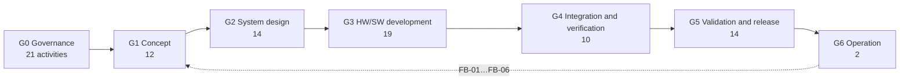

# Process maps

The integrated process model ([WP-P-11](../assurance/process/README.md)) records every phase as activities in
discipline lanes, linked by work products, with cross-domain interfaces and the confirmation measures of the gate.
The maps are generated from the model and checked by CI, so they cannot disagree with the register, the safety plan
or the confirmation plan. This page explains how to read them and links each one; the maps themselves are Mermaid
diagrams rendered by GitHub.

## The lifecycle map (L0)

[`maps/lifecycle.md`](../assurance/process/maps/lifecycle.md): the seven phases with how many activities each has,
the feedback routes from operation into earlier phases, and the exit criterion of each gate.

*A summary drawn for this page; the generated map carries the live counts.*

## The phase maps (L1)

| Map | What to look for |
|---|---|
| [G0 Governance](../assurance/process/maps/g0-governance.md) | The plans and procedures every later phase reads from; the roles still unassigned; whether the discipline plans and the safety plan agree on who holds each role |
| [G1 Concept](../assurance/process/maps/g1-concept.md) | The risk assessment lane feeding the control-system lane; the one open interface (the detection means for the protective stop); six confirmation measures, none performed |
| [G2 System design](../assurance/process/maps/g2-system-design.md) | The serial chain from SRS to the independence analysis in the control-system lane; the stability analysis the stopping budget depends on; the safety–security interface in the architecture |
| [G3 HW/SW development](../assurance/process/maps/g3-hw-sw-development.md) | The PL calculation waiting on fault lists, certificates and the CCF score; firmware hardening starting from a reproducible build; the safety-parameter integrity interface |
| [G4 Integration and verification](../assurance/process/maps/g4-integration-and-verification.md) | Every on-ground test under the hold point; stopping distance measured before the protective fields are validated |
| [G5 Validation and release](../assurance/process/maps/g5-validation-and-release.md) | The three arguments meeting in the safety case; the assessments in the independent lane; the technical documentation shared with the AI Act record |
| [G6 Operation](../assurance/process/maps/g6-operation.md) | Field monitoring and incident response; the six feedback routes back into the concept phase |

## How to read a phase map

1. **Swimlane map.** One box per discipline lane; green activities are joint work and sit outside the boxes. An
   arrow is a work-product input: the activity at its head cannot finish before the one at its tail. Yellow boxes in
   the "Independent confirmation" lane are the confirmation measures the gate needs.
2. **Interface map.** A dotted edge between two lanes lists the cross-domain interfaces between them, each
   anchored to text that occurs verbatim in both work products. "OPEN" marks one a recorded open item still has to
   settle.
3. **Activities table.** Every activity with its lane, the work products it produces, its inputs, the clause
   references of those work products (read from the register) and their status.
4. **Clause coverage by standard.** Which activity answers each clause reference, per standard. One activity
   answering several standards is the point of an integrated lifecycle.
5. **Gate readiness.** The exit criterion, the status count of the gate's work products, the roles the lanes need
   and who holds them, the confirmation measures and whether a record exists, the work products that get only a
   verification review, and the open interfaces due.

## Gate skeletons

For each gate the model also generates a pre-filled gate review skeleton in
[`10-safety-case/gates/skeletons/`](../assurance/10-safety-case/gates/skeletons/): the gate's work products with their
status and open-item counts, the confirmation measures and whether their records exist, the open interfaces, the
unassigned roles and the exit criteria as rows to fill. A skeleton is not a gate review; holding one means copying it
to a dated file and re-checking every value at the review baseline ([gates README](../assurance/10-safety-case/gates/README.md)).

## Changing the model

The model is data in [`assurance/process/model/`](../assurance/process/model/): phases, lanes, activities, reviews,
interfaces and feedback routes in a flat YAML subset. Edit the records, run
`python3 assurance/process/tools/process_model.py`, and commit the records with the regenerated maps and skeletons.
The checker (`--check`) fails in CI when a map is stale, an anchor disappears from a work product, a work product the
register gates in a phase has no producing activity, or the gate's confirmation measures differ from
[WP-M-06 §9](../assurance/01-management/WP-M-06-confirmation-measures-plan.md#9-schedule-summary).
