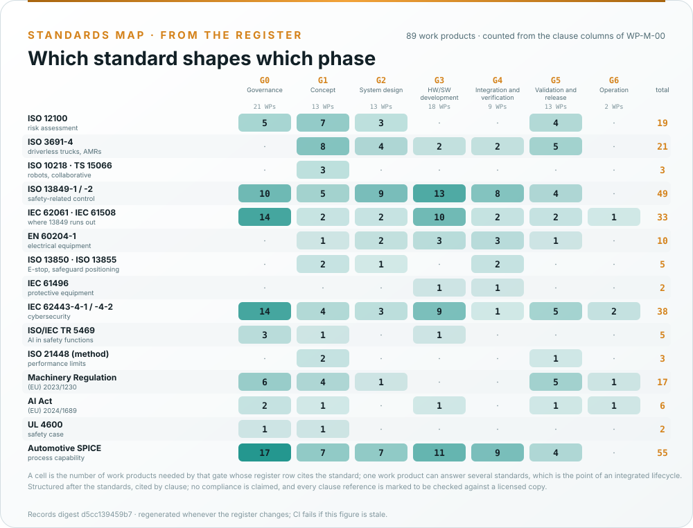
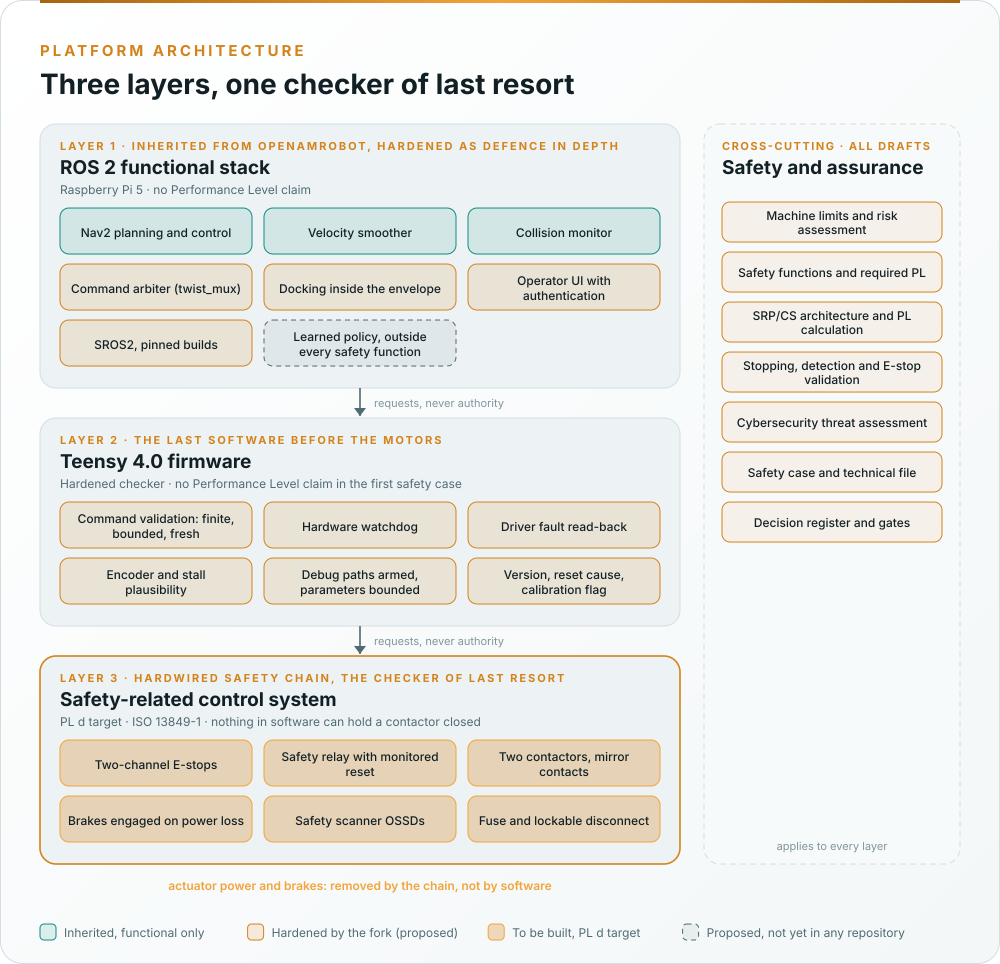

# Standards at a glance

The fork follows standards-informed development: its work products are structured after these standards and cite
their clauses. **No compliance is claimed**, because no assessment has been performed. The
[assurance strategy, WP-M-01](../assurance/01-management/WP-M-01-assurance-strategy.md) explains how each standard is
tailored to an open-source assurance record for research hardware; [How we use each standard](How-we-use-each-standard.md)
is the page-length version of this table.

## Where each standard lands in the lifecycle

*Counted from the clause columns of [WP-M-00](../assurance/01-management/WP-M-00-work-product-register.md) by
[`make_assets.py`](../docs/assets/openamrobot/make_assets.py); one work product can answer several standards, which
is the point of an integrated lifecycle. The [process maps](Process-maps.md) show the same work as activities in
discipline lanes.*

## The standards, and the question each answers

| Standard | The question | Main work products |
|---|---|---|
| **ISO 12100**, risk assessment and reduction | What could hurt someone, and how much risk reduction does it need? | [Item definition, WP-C-01](../assurance/02-concept/WP-C-01-item-definition.md) · [Risk assessment, WP-C-03](../assurance/02-concept/WP-C-03-risk-assessment.md) · [Risk reduction concept, WP-C-05](../assurance/02-concept/WP-C-05-risk-reduction-concept.md) |
| **ISO 3691-4**, driverless industrial trucks and AMRs | Which safety functions must a driverless machine have? | [Safety functions and PLr, WP-C-04](../assurance/02-concept/WP-C-04-safety-functions-and-plr.md) · [Operating environment, WP-C-02](../assurance/02-concept/WP-C-02-operating-environment-and-tasks.md) |
| **ISO 13849-1/-2**, safety-related parts of control systems | How reliable must the control system be, and how is that shown? | [SRS, WP-S-02](../assurance/03-system/WP-S-02-safety-requirements.md) · [Architecture, WP-S-03](../assurance/03-system/WP-S-03-technical-safety-concept.md) · [PL calculation, WP-H-04](../assurance/04-hardware/WP-H-04-reliability-data-and-pl-calculation.md) · [Validation, WP-V-01](../assurance/06-validation/WP-V-01-safety-validation.md) |
| **EN 60204-1**, **ISO 13850**, electrical equipment and emergency stop | Is the electrical installation safe, and does the E-stop work? | [Electrical safety, WP-H-05](../assurance/04-hardware/WP-H-05-electrical-safety.md) · [E-stop validation, WP-V-04](../assurance/06-validation/WP-V-04-emergency-stop-and-safety-chain-validation.md) |
| **ISO 13855**, **IEC 61496**, safeguards and protective equipment | Where may a person be relative to the robot? | [Stopping budget, WP-S-04](../assurance/03-system/WP-S-04-response-time-and-stopping-budget.md) · [Detection validation, WP-V-03](../assurance/06-validation/WP-V-03-personnel-detection-validation.md) |
| **IEC 62443-4-1/-4-2**, cybersecurity | What if someone attacks it? | [Threat and risk assessment, WP-C-07](../assurance/02-concept/WP-C-07-cybersecurity-threat-and-risk-assessment.md) · [Cybersecurity architecture, WP-S-07](../assurance/03-system/WP-S-07-cybersecurity-architecture.md) · [Cybersecurity case, WP-K-03](../assurance/10-safety-case/WP-K-03-cybersecurity-case.md) |
| **ISO/IEC TR 5469**, AI in safety functions | How far can a learned component be trusted? | [ML component definition, WP-C-09](../assurance/02-concept/WP-C-09-ml-component-definition-and-safety-requirements.md) · [ML engineering, WP-W-10](../assurance/05-software/WP-W-10-ml-engineering.md) |
| **UL 4600**, safety case | Is the whole argument convincing? | [Safety case, WP-K-01](../assurance/10-safety-case/WP-K-01-safety-case.md) |
| **Machinery Regulation (EU) 2023/1230**, **AI Act** | What does the law require? | [Regulatory strategy, WP-M-13](../assurance/01-management/WP-M-13-regulatory-conformity-strategy.md) · [Technical documentation index, WP-K-02](../assurance/10-safety-case/WP-K-02-technical-documentation-index.md) |

## Supporting practices

| Practice | Where it is applied |
|---|---|
| IEC 62061 and IEC 61508 | Management, assessment and software where ISO 13849 runs out: [WP-M-06](../assurance/01-management/WP-M-06-confirmation-measures-plan.md), [WP-W-02](../assurance/05-software/WP-W-02-software-safety-requirements.md) |
| ISO 21448 as a method | [Insufficiency analysis, WP-C-10](../assurance/02-concept/WP-C-10-functional-insufficiency-analysis.md) · [Field trials, WP-V-08](../assurance/06-validation/WP-V-08-unknown-scenarios-and-field-trials.md) |
| Automotive SPICE | [Capability baseline, WP-M-12](../assurance/01-management/WP-M-12-process-capability-baseline.md): a self-assessment, not a formal assessment |
| Safety analysis | [FMEA](../assurance/08-analyses/WP-A-01-system-fmea.md) · [FTA](../assurance/08-analyses/WP-A-02-fault-tree-analysis.md) · [CCF](../assurance/08-analyses/WP-A-03-common-cause-failure-analysis.md) · [STPA](../assurance/08-analyses/WP-A-04-stpa.md) · [Independence of the chain](../assurance/08-analyses/WP-A-05-independence-of-the-safety-chain.md) |
| Integrated process model | [WP-P-11](../assurance/process/README.md) and the [process maps](Process-maps.md) |
| Independent review | [Confirmation measures plan, WP-M-06](../assurance/01-management/WP-M-06-confirmation-measures-plan.md) · [Verification and review procedure, WP-P-05](../assurance/07-supporting/WP-P-05-verification-review-procedure.md) |

## How they fit together

One shared **hazard log** (the risk assessment, with cybersecurity, insufficiency and misuse cross-references) and
one **requirements database** (in [`assurance/trace/`](../assurance/trace/README.md), hazards and assumptions first) hold the
standards together:

| Topic | Primary standard | Interface |
|---|---|---|
| Hazards of the machine | ISO 12100, ISO 3691-4 | Every other analysis rates its findings against this hazard list |
| Safety functions and their PL | ISO 3691-4, ISO 13849-1 | The required PL comes from the risk graph on the hazard; the achieved PL from the chain's calculation |
| Performance limits of sensing | ISO 21448 method | Insufficiencies close as safety functions or operating-environment limits |
| Attacks that cause hazards | IEC 62443 | Threat scenarios link to hazards; the chain is a zone with no network conduit |
| Learned components | ISO/IEC TR 5469 | None carries a safety function; the chain is the independent safeguard |
| Conformity | Machinery Regulation | The technical file indexes the register |

## The central argument: a checker of last resort

The ROS 2 stack proposes, the firmware checks, and a hardwired safety chain is the checker of last resort that
nothing in software can override. Only the chain carries a Performance Level target.

*The README architecture figure, generated by [`make_assets.py`](../docs/assets/openamrobot/make_assets.py). The strategy is [WP-M-01 §6](../assurance/01-management/WP-M-01-assurance-strategy.md#6-safety-architecture-argument-the-central-strategy).*

## Tailoring decisions worth knowing

The machinery standards assume a manufacturer placing a finished machine on the market. The fork is an open-source
assurance record for research hardware built by someone else. The strategy records fourteen tailoring decisions,
each needing confirmation by an independent assessor. The ones that shape the project most:

- **Modification of existing machinery.** Nothing is reused from upstream as a safety work product, because none
  exists; the fork does a full concept phase.
- **Safety functions on a hardwired chain.** The firmware and the ROS 2 stack are hardened as defence in depth and
  carry no PL claim.
- **Certified components.** The safety relay, contactors, scanner and brakes are bought with certificates; the
  inherited drivers and motors are treated as not safety-related because the chain removes power upstream of them.
- **Proven in use is not claimed.** Upstream's run history is supporting evidence only.
- **Independence.** The author never reviews their own work. With a single maintainer, confirmation reviews and
  the functional safety assessment need an external assessor.
- **Regulatory.** EU frame, Machinery Regulation; the conformity module is a decision for the lead.

The full table is in [WP-M-01 §5](../assurance/01-management/WP-M-01-assurance-strategy.md#5-tailoring). Which
clauses each assurance folder answers to is in [`assurance/README.md`](../assurance/README.md#layout).
